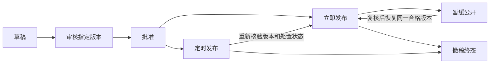
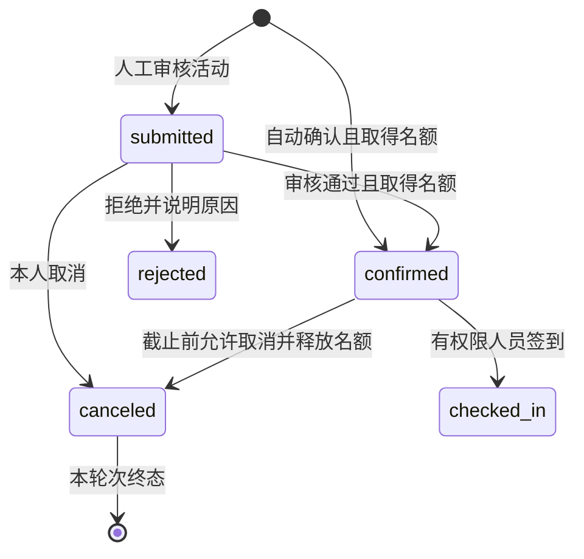

# 机器人生态赛事活动与动态资讯平台产品技术方案

日期：2026-10-18。适用项目：summon-mecha。本轮交付为只读审计、产品与技术设计、工程任务及验收标准，业务代码和业务数据库尚未改造。

当前应建设能够长期运营的赛事活动系统和可信资讯系统。赛事既要帮助用户找到机会，也要让主办方处理报名、规则变更和赛后争议；资讯既要提供可核验的行业内容，也要处理来源、修订和撤稿。首页卡片只是分发入口，不能作为系统完成的判据。

首期按“平台编辑发布、自营或明确授权活动、免费报名”提出方案；收费票务和合作方自行发布分别设立扩展门槛。该口径是尚待业务确认的建议，不是已批准或已开发的能力。“动态资讯”在本方案中指资讯、公告、案例和赛况，不包含另一个业务中的方案咨询。

建议首个可运营版本覆盖G0–G2及必要的真实分享、查询和质量工作；G3完整人工赛务按首场目标赛事规则推进，G4再完成生态分发和规模运营。头部平台是长期建设目标，首期范围不等于复制所有赛制和媒体业务；各阶段都必须有可独立运营、可验证的交付。

配套文件：[工程任务与验收矩阵](Ecosystem-Engineering-Backlog.md)、[现状审计](Ecosystem-Current-Audit.md)、[官方实践依据](Ecosystem-Official-References.md)。

## 1 当前基线与必须先修的问题

2026-10-18只读检查主库 `summon_mecha_local`：赛事0条、报名0条；`GET /api/events`实际返回`data:[]`，浏览器仍显示8条样例。默认10个CMS静态页不是资讯，1条`marketing_events`不是机器人赛事。

| 优先级 | 已确认的问题 | 工程后果 |
|---|---|---|
| 阻断正式报名 | 空列表和请求失败均保留样例，样例ID可进入真实报名请求 | 必须清除正式环境样例及其写入口，空态和故障态分别展示 |
| 阻断运营使用 | 后台赛事路由缺ACL映射；报名DataGrid读取完整联系人，通用请求可开启导出 | 服务端逐动作授权、资料范围和导出权限必须先完成，不能只隐藏菜单 |
| 阻断名额承诺 | 报名是exists后create，没有事务、唯一约束、容量或截止时间 | 当前是联系人提交，不是可靠的名额分配系统 |
| 阻断信息真实性 | 赛事时间、队伍数、热度、奖金、往届效果和资讯机构标记来自样例 | 没有真实来源和统计依据的值不发布，不用默认数字填充 |
| 阻断内容运营 | 动态无文章模型/API；互动多为内存变化；无详情地址 | 资讯必须有持久身份、版本和运营发布流程 |
| 重要缺陷 | 后台编辑模板未回填现有值；赛事详情未使用已有详情API | 修复编辑丢字段风险，详情按ID读取，不依赖首页内存对象 |

后台授权及并发危险来自源码审计，本轮未通过写入主库、导出真实资料或制造并发故障来验证。截图仅证明当前界面，不证明其中赛事、机构声明或政策标题真实。详见现状审计。

## 2 平台定位与业务边界

赛事活动承担机会发现、组织参与和开发者供给连接；动态资讯承担可信信息分发、活动传播和技术成果展示。与机器人生态的连接必须落实到具体对象：主办机构、参赛队伍、机器人机型、技能作品、服务案例和可回查的活动结果。

| 对象 | 平台应提供的能力 | 不能混同的概念 |
|---|---|---|
| 机器人赛事 | 届次、赛项、规则、资格、队伍、作品、赛程、成绩、申诉、奖项 | 联系表不是参赛资格；获奖不是技能安全审核通过 |
| 沙龙和工作坊 | 议程、讲者、席位、报名、审核、签到、变更通知 | 人数不是参赛队伍数，不套用对战成绩 |
| 展会和开放日 | 主办方、地点、开放安排、观众/参展申请及官方外链 | 外部报名不产生本平台报名成功凭证 |
| 动态资讯 | 作者、来源、原文和平台时间、正文、关联对象、更正撤稿 | 官方来源不等于该机构在平台开通了官方账号 |
| 技术案例与参赛作品 | 来源、授权、适用机型和验证范围、活动关联 | 展示或获奖不自动生成可售商品、部署任务或授权 |

外部赛事先提供核验后的目录和官方报名链接。只有自办或获得明确承办授权的活动才能开启站内报名；页面要标明平台角色。报名收款、奖金打款、押金、抽佣和结算不进入免费报名方案。

继续使用uni-app和Bagisto/Laravel模块化单体。设备归属、技能审核、交付通道、开发者门户保持既有边界。赛事队伍是参赛单位及队长操作权限，不借此建设开发者团队RBAC、社交网络或机器人控制系统。

## 3 角色与任务

| 角色 | 主要任务 | 授权边界 |
|---|---|---|
| 访客 | 查询已发布活动/资讯，查看来源及官方外链 | 不读取报名联系人、草稿、审核意见和私有材料 |
| 登录客户 | 提交本人报名，查看回执，取消或按规则重报，管理收藏 | 客户身份来自令牌，不接受请求自报customer_id |
| 队长和队员 | 在赛务阶段管理队伍、确认成员、提交参赛作品 | 队长权限限定本队；成员与资格按当届快照冻结 |
| 内容编辑 | 建草稿、处理来源与媒体、提交审核 | 不能用编辑权限发布、撤稿或读取报名资料 |
| 发布审核员 | 审核指定版本、发布、暂缓、更正和撤稿 | 审核结论绑定正文、来源、附件与规则摘要，不继承到新版本 |
| 活动运营 | 配置活动、审核申请、变更安排、取消活动 | 资料查看、导出和签到单独授权，受活动范围限制 |
| 裁判和裁决人员 | 录入/复核成绩，处理符合规则的申诉 | 录分、发布和裁决分权；不能通过普通编辑覆盖终审结果 |
| 平台管理员 | 配置权限、紧急处置、审计与故障恢复 | 不默认向全部运营角色开放新PII权限 |

这些是产品职责，不意味着已经存在相应员工或账号。实施时每个工程包指定实现人、复核人和签收人；业务规则由活动负责人和内容负责人确认。

## 4 用户与运营旅程

### 4.1 普通活动

发现和筛选 → 独立详情 → 查看主办角色、时间地点、规则与隐私说明 → 登录后续办 → 提交 → 明确显示“待审核”或“已确认” → 我的报名和站内消息 → 变更确认/取消 → 签到 → 活动回顾。

待审核不能显示“已获得席位”。外部报名只跳转经过审核的官方目标，并说明结果由外部主办方处理。当前没有短信/微信订阅能力时，页面只承诺在应用内可回查的结果。

### 4.2 机器人赛事

选择届次和赛项 → 阅读适用规则版本 → 组队和资格确认 → 冻结当届成员/机器人声明 → 报名审核 → 按截止时间提交作品 → 查看已发布赛程 → 查看暂定成绩 → 按规则提出申诉 → 人工裁决与修订 → 终审成绩/奖项 → 授权作品展示或进入现有技能提审流程。

机器人型号和安全声明是主办方审核的参赛资料，不等同于平台完成真机检测或取得厂商许可。赛前安全检查和现场应急由活动负责人落实，不能用网页勾选代替现场验证。

### 4.3 动态资讯

编辑录入自有/授权内容或来源摘要 → 核对作者、机构、事实与权利依据 → 媒体和富文本处理 → 机审辅助及人工审核 → 发布指定版本 → 首页/列表/独立详情/分享 → 更正、暂缓或撤稿 → 检查公开路径和关联内容已同步。

先做平台编辑内容。评论、点赞、社区加入和合作方自助投稿在有真实持久化、身份、审核及处置能力前不展示为可用功能。

## 5 页面与信息架构

保留首页“生态中心”作为精选预览，增加“查看全部”和能直达的业务页，不继续把完整详情塞在首页组件里。

| 页面 | 主要信息和操作 | 必须处理的状态 |
|---|---|---|
| 活动列表 | 类型、城市、日期、报名状态；稳定分页和排序 | 加载、空、故障、筛选无结果、恢复滚动位置 |
| 活动详情 | 主办角色、来源、时间/时区、地点/线上方式、规则、资格、报名动作、变更记录 | 草稿不可见、撤回、取消、延期、已满、已报名、外部报名 |
| 报名表及回执 | 固定版本表单、规则/隐私确认、字段错误、状态和报名编号 | 处理中、超时待确认、幂等重放、审核中、拒绝、取消、重报 |
| 我的报名 | 当前状态、有效安排、审核结果、签到和操作历史 | 本人范围、跨账号保护、历史活动可回查 |
| 资讯列表及详情 | 分类、标题摘要、作者/机构、来源、首次/更新时间、关联活动/机型/技能 | 空、故障、来源失效、更正、暂缓、撤稿 |
| 赛务页面 | 当届规则、赛项、队伍、作品、赛程、成绩和申诉 | 未发布不泄露；成绩版本、暂定/终审与申诉窗口明确 |
| 运营后台 | 草稿/审核队列、预览、版本差异、报名处理、通知任务、赛务、处置台 | 逐动作权限、范围约束、并发编辑冲突、失败可恢复 |

H5复制真实详情URL后才能提示成功；小程序使用实际详情路由和分享钩子，失败有反馈。没有可分享详情时不提示“已复制链接”。保留登录前的目标和有限表单草稿，登录失败不把表单当成功提交。

登录回跳只接受允许列表内的站内路径。续办草稿绑定活动、表单版本和有效期：先登录再收集联系人，令牌失效时PII仅留当前页面内存；持久化只允许非敏感选项及绑定原操作者的待查请求键。登录后重取详情和allowed_actions，同账号才恢复；退出或切换账号清除私有状态。规则/隐私版本变化清除旧勾选，重新阅读后显式提交，禁止自动续交。

移动端至少验证375/390px窄屏、键盘、长标题和大字号。按钮可聚焦并有可访问名称，错误与字段关联，状态不只靠颜色表达。以相关[WCAG 2.2](https://www.w3.org/TR/WCAG22/)要求作为工程验收参考，不在未完整审计时宣称取得合规认证。

## 6 状态模型

### 6.1 发布、举办和报名分开

- 发布工作流：draft → in_review → approved → scheduled/published；审核拒绝退回草稿。发布指向明确的已审版本。
- 处置状态：normal、withheld、retracted。暂缓可经过复核恢复；撤稿为终态。撤稿对象及旧正文不得换ID直接再分发；确需另发纠正报道，独立核实并按新稿重新审核，关联中性撤稿说明，原对象保持终态。
- 举办安排：scheduled、postponed、rescheduled、completed、canceled。取消为终态；待定延期不编造新日期，确定改期保留原安排。
- 报名可用性根据发布、举办状态、开关、时间窗、容量、身份和已有报名计算，返回can_register、稳定reason及allowed_actions，不另存一套容易漂移的前端状态。

外部活动的开放状态只代表最近核验到的官方信息。公开时间、报名时间和举办时间分开，符合[RobotEvents官方指南](https://kb.roboticseducation.org/hc/pt/articles/4808321634199-Publicando-um-evento-em-RobotEvents-com)的信息组织方式；本项目不复制其全部规则。

### 6.2 报名与名额

建议首期支持自动确认和人工审核两种活动。自动确认在提交成功时占位；人工审核的submitted不占已确认席位，界面明确“待审核，不保证名额”，批准时才在同一事务分配名额。每个活动必须选定计量单位，不能混用人数和队伍数。

重报保留同一报名身份但创建新attempt和规则/隐私快照。旧请求、旧取消指令和旧票证不得作用于新轮次。签到后不能普通自助取消；运营纠错是独立有理由、有权限、有审计的动作。

新轮次从起点按审核方式进入submitted或confirmed，不能把旧canceled轮次恢复。confirmed_count只计当前confirmed/checked_in轮次；签到仍占名额。人工审核不是候补，容量已满时默认拒绝新的申请；如需继续收申请，应另行确认等待及通知政策。

申请截止和审核截止分开：建议允许及时提交的申请在审核截止前继续审批；活动取消、资格不符或名额不足仍会阻止确认。具体截止、取消和重报口径在上线前由活动负责人确认。

候补不混入首期名额算法。增加候补时必须另行实现排队顺序、补位资格、确认期限及名额释放；功能未上线时“已满”就明确拒绝，不能显示候补成功。

## 7 数据模型与关键约束

以下是拟新增或扩展的逻辑对象，最终物理迁移由字段评审冻结，不应一次创建所有后期表。当前MySQL为5.7，不能把CHECK约束或部分唯一索引当成现有可用保障。

| 阶段 | 对象 | 关键字段或关系 | 约束和用途 |
|---|---|---|---|
| G1 | events既有表 | kind、organizer、participation_mode、published_revision_id、working_revision_id、举办状态、结构化时间、timezone、row_version | 保留既有ID；公开和工作指针物理分开；旧date仅作待校正原值 |
| G1 | event_revisions | event_id、revision_no、展示内容、来源、规则摘要、审核人及正文指纹 | 唯一event/revision；发布只读已审快照；编辑草稿不覆盖公开页 |
| G1 | ecosystem_organizers | 主体名称、平台角色、来源和授权证据、核验人/时间 | 不拿商品seller自动推定活动主办权；证据分公开资料和私有依据 |
| G1 | event_rule_versions | 适用活动/赛项、版本、正文或外链、权威语言、指纹、变更摘要、生效安排 | 报名绑定具体版本；只获外链许可的文件不复制存储 |
| G1 | content_posts / content_revisions | 类型、slug、分类、published_revision_id、working_revision_id、作者/来源、原文/平台时间、处置版本 | 资讯与协议CMS分域；公开与草稿指针分开；提交/批准版本不可变 |
| G1 | 内容来源与媒体引用 | 来源名/URL/核验时间/权利依据；媒体类型、哈希、存储key、审核态和引用 | 原创/供稿/获准转载/链接摘要分别校验；不存任意可执行HTML或任意外抓URL |
| G2 | event_registration_scopes | event_id、scope_key、容量/无限容量、计量单位、confirmed_count、审核方式 | unique(event_id,scope_key)；首期每活动一个真实scope；赛项扩展复用 |
| G2 | event_registrations既有表 | event_id、scope_id、owner_customer_id、subject_key、public_no、current_attempt_id、row_version | unique(scope_id,subject_key)；subject_key由服务器生成，不能自报他人ID |
| G2 | event_registration_attempts | attempt_no、表单/资格/规则/隐私快照、状态、处理人和时间 | unique(registration_id,attempt_no)；保留历史轮次，不让重报覆写过去 |
| G2 | event_changes / change_acknowledgments | 变更版本、影响轮次快照、接受/拒绝/待确认、截止及处理政策 | unique(change_id,attempt_id)；原同意快照保留；不自动推定接受 |
| G2 | event_staff_assignments | event_id、后台用户、活动职责、有效期 | 通用ACL能力与活动范围同时满足；拥有赛事查看权限不等于能处理所有主办方资料 |
| G2 | 幂等请求与操作记录 | actor/action/request_key、payload_hash、目标轮次、结果引用 | 业务键唯一；同key不同载荷409；不把手机号或完整响应当日志 |
| G1基础/G2消息扩展 | ecosystem_outbox | 业务键、聚合/版本、租约/token、收件人或扇出游标、状态、次数、next_at、通知引用 | G1先建同事务记录/发布消费，G2扩展消息扇出；通知创建与消费记账同事务 |
| G3 | competition_tracks / teams / entries | 届次/赛项、队长/成员、报名及资格/机器人声明快照 | 参赛身份与客户账号分开；成员冻结后不被队伍日常修改追溯覆盖 |
| G3 | submissions / stages / matches | 作品版本、截止、资格、阶段/场次、参赛单位、时间和状态 | 跨赛项引用拒绝；无合法规则不运行自定义排名公式 |
| G3 | score_revisions / appeals / awards | 适用规则、成绩版本、复核发布、申诉与裁决、获奖依据 | 发布版本唯一；改分留历史；奖项关联结果版本，修订后可标记待复核 |
| G4 | 收藏/关联与统计事实 | 客户与目标唯一关系；活动/资讯/机型/技能显式关联；真实访问与转化事实 | 不能用可编辑hot/teams冒充指标；公开名单不含私有联系人 |

既有报名event_id为unsigned int，赛事id为bigint，先统一类型再建外键。历史匿名报名不得仅凭新用户填写同手机号就认领；保留在受限历史区，认领要有另行确认的验证方案。旧记录重复/孤儿先生成核查报告，不静默删除或合并。

新增subject_key、scope_key和request_key等身份/唯一键必须NOT NULL、限定长度及ASCII或二进制比较语义，按MySQL5.7实际索引上限设计。客户端不能指定范围后再借其他聚合的ID写入；锁后逐层核验scope.event_id、registration.scope/event及attempt.registration均属于当前目标。

草稿中的日期、规则和资格提案不直接改写正在生效的报名守卫。批准发布时按同一event锁原子切换公开版本及生效字段；已有报名后，改期、资格/规则实质变更和取消使用独立变更命令，保存影响快照并通知。历史报名保留原接受版本；变更是否必须重新确认由已公布规则决定，不替用户自动勾选新版。

需要重新确认的变更必须定义影响轮次、确认截止、接受/拒绝入口、未确认处置及席位/签到后果；这些政策缺失时不得发布该变更。我的报名展示待办，原同意快照不覆盖。到期处置或拒绝导致释放名额时仍走同一锁协议；通知送达不能替代用户确认。

新时间字段明确采用UTC语义并在API返回ISO 8601和活动timezone。现有应用默认Asia/Shanghai，不全局改动其余商城模块；新领域读写使用明确转换，迁移不依赖数据库隐式时区。起止不明的外部预告可展示待定，但不能因此开启站内报名。

## 8 报名一致性协议

所有提交、批准、取消、名额调整和活动关闭入口采用同一协议，不能只给新报名方法加锁。建议锁顺序为event → scope按ID排序 → team如适用 → registration → attempt → outbox。跨领域关联不在该事务中直接修改商品或技能授权。

1. 认证并校验请求归属及载荷指纹。先识别已完成的幂等请求：同操作者、动作、目标、载荷的重放返回原结果引用及该轮次当前状态；即使现已截止或重新报名，也不重新执行，不把旧结果冒充新轮次成功。
2. 只有新命令进入业务守卫：事务内按统一顺序加锁，使用当前读重新核验聚合归属、发布版本、当前时间、规则/隐私版本和已有轮次。并发首次请求由唯一约束及可重放事务收敛；同key不同载荷409，不能以exists替代防重。
3. 自动确认或审核批准时原子分配名额；人工待审不计已确认席位。容量为null表示不限，0表示没有名额，未知容量不能自动当不限。
4. 取消/拒绝/审核竞争按预期row_version和attempt_id判断。只有有效confirmed→canceled才能释放一次；降低容量不能小于已占名额。
5. 报名、次数/席位变化、操作审计及outbox一起提交或回滚。外部调用与文件解析不持有活动行锁。
6. 超时不代表失败；客户端按request_key查询，不盲目换key重报。死锁重试只覆盖可重放的本地事务，不重放外部副作用。

报名可用性必须在等锁后再判断时间，避免请求开始时未截止、取得锁时已截止却仍录入。RR旧快照、审核抢最后名额、取消释放和关报名竞争要用真实MySQL两连接/多进程验证。[Laravel 11查询构建器](https://laravel.com/docs/11.x/queries#pessimistic-locking)提供悲观锁工具，但项目正确性仍依赖所有写方共用协议及数据库唯一约束。

活动取消先原子提交canceled及变更版本，后续读写、回执和签到立即服从该状态；联系人通知可以异步。大批量履历和通知按可恢复游标处理，不能让“还没发完通知”意味着仍可报名。收件人取取消时适用的报名快照，不用不断变化的筛选条件导致分页漏人。

凭证使用绑定attempt的不可预测token；取消、重报或凭证重发后旧token失效。旧消息直达其原轮次的只读履历，可另提供当前轮次入口，不复用旧操作按钮。签到同时核验员工活动范围、当前举办状态、有效轮次及适用变更确认；重复扫描返回原签到事实。网络离线只能显示“未核验”，不得给出绿色成功。

## 9 完整赛务设计

规则是每届赛事的依据。记录赛项、资格、作品要求、评分维度、同分办法、申诉主体/时限/证据类型和裁决权限；未确定的规则不能由代码默认补齐。FIRST官方将手册、更新和赛季档案区分管理，并限制资料重托管，故本项目保存规则版本和权利依据，外部文件优先官方链接。[FIRST赛季资料](https://www.firstinspires.org/resources/library/frc/season-materials)

- 组队：队长邀请、成员接受、离队/移交、资格核验及冻结；一人能否多队、多赛项按规则约束，不能靠前端列表去重。队伍名称可公开，私人联络资料和身份材料分开。
- 作品：草稿、正式提交、截止锁定、补正、审核和展示版本分开。资格材料私有；代码、视频和包不能未经许可公开。涉及现有技能包时仍走既有上传与安全审核流程。
- 赛程：支持人工编排和预览导入；参赛单位、场次、场地和时间冲突验证后才发布。先不承诺自动抽签、全球联赛或实时裁判设备接入。
- 成绩：录入草稿→独立复核→暂定公布→申诉处理→终审。使用规则确定的数值精度和计分策略；没有同分政策不自动捏造名次。
- 申诉：关联场次、规则和成绩版本，校验提出者及窗口；受理、取证、裁决和通知可追溯。重赛生成新场次/结果关联，原记录不消失。
- 奖项：关联核准结果版本，区分待公布、已公布、待复核；奖金说明与支付事实分开。获奖作品进入展示或提审，不自动上架、发license或产生部署任务。

RoboMaster按赛项和场次公开申诉及重赛处理，为“场次关联、裁决理由和成绩修订留痕”提供参考；不照搬其具体分钟数、证据规则或处罚。[RoboMaster申诉公告](https://www.robomaster.com/zh-CN/resource/pages/announcement/1908)

## 10 资讯编辑发布与内容治理

资讯类型先支持行业信息、技术解读、平台公告、活动赛况和案例。原创、官方来源摘要、授权供稿、获准转载和商业合作有不同的必填来源/授权字段。来源核验只产生“官网来源/官方原文”说明；机构账号或合作徽章另需主体控制或授权、核验范围及有效期。首期未建账号核验就不显示机构认证徽章；来源摘要不授予全文、图片或改编权。

作者、发布机构、原文时间、平台首次发布时间、更新时间和事件发生时间分字段。普通修改不刷新首次发布制造新鲜度。行业信息与政策标题要核对原文；没有来源的样例声明不进入正式库。Open Robotics新闻的作者/机构与日期展示是可参考的基础信息表达。[Open Robotics News](https://www.openrobotics.org/blog)

审核批准绑定不可变revision的内容指纹和媒体集合。编辑已发布内容时生成新草稿，旧合格版本继续公开；来源、正文或附件发生实质变更后必须重新审核。采用row_version防两个编辑者静默覆盖。

定时发布检查“当前批准版本、计划时间、处置状态、来源权利和媒体可用性”，不能只拿文章ID恢复公开。首期只由平台编辑操作，不直接开放外部账号写富文本。

更正有可见说明、原因、责任编辑和时间，保留首发时间。暂缓与终态撤稿区分；撤稿后正文、附件、历史版本API、推荐、搜索摘要、分享信息和缓存都必须停止公开。必要审计证据受限保存，不能默认永久公开旧版本。这借鉴[AP更正与归属原则](https://www.ap.org/about/news-values-and-principles/telling-the-story/)及[IPTC发布处置语义](https://www.iptc.org/std/NewsML-G2/2.34/specification/NewsML-G2-2.34-specification.html)，不引入完整新闻交换协议。

撤稿URL返回中性说明及合适的HTTP终态，不回显含敏感内容的旧标题/正文；暂缓不能被表示成永久删除。已取消活动保留活动身份与变更说明，不能通过删赛事和报名来取消活动。

内容范围和资质由负责人结合实际经营确认，技术上先提供来源、编辑、审核和处置记录；不能因栏目叫“机器人资讯”就推定全部豁免或全部需要同一种许可。正式开放前核定[网络信息内容生态治理规定](https://www.cac.gov.cn/2019-12/20/c_1578375159509309.htm)及[互联网新闻信息服务管理规定](https://www.cac.gov.cn/2017-05/02/c_1120902760.htm)与实际业务的适用范围，不能把本方案当完整法律审查。

## 11 权限 隐私与文件安全

后台逐路由覆盖list/create/store/edit/update/review/publish/withhold/retract/registration/PII/export/checkin/result/appeal等动作。菜单、按钮和Ajax查询必须使用同一授权能力；新增路由未登记权限应在本模块拒绝并使测试失败，不全局改坏其他Bagisto模块。

G0先默认关闭全部站内报名写入口，包括旧route。G1只开放可信目录及外部官方报名；G2身份、同意、名额、全写方守卫和新客户端验收后，才能逐活动启用站内报名。活动人员分配在G2完成前，自定义运营角色的PII读取和导出一律拒绝；如确需处置，仅保留已授权超管的最小范围路径，不能因菜单可见而临时放开全表。

公开DTO、本人报名DTO、运营DTO和PII读取分开构造，禁止直接序列化Eloquent整模型及关联。报名手机号默认遮罩；解密/查看、导出分别授权和审计，通知只含状态和受权详情链接。联系人是联络数据，不是已验证实名，首期不凭电话号码自动认领历史报名。

资料收集只包含活动必要项。证件、监护人资料、特殊资格或现场安全材料须先确定处理与权限方案；不支持的资格模型不能用普通联系人表单假装完成。留存期限、账号注销、材料删除与审计保留在上线前确定并配置，未批准的清理任务先做dry-run，不自行批量删历史记录。

联络资料与公开参赛信息分区存储，必要姓名/手机号等字段按批准策略加密；检索所需摘要使用带密钥的方式，不存可穷举的裸手机号散列。迁移适配密文字段长度，验证旧明文处理及密钥轮换/恢复，不依赖当前数据库strict=false时的静默截断。

上传按类型允许列表、真实解码/签名、大小和数量限制处理，使用生成存储名，阻止脚本、危险链接、路径穿越和伪造MIME。仓库已有HTMLPurifier和Intervention Image可评估复用；实际净化策略须有恶意样本回归，关键词扫描不能代替XSS防护。[OWASP文件上传](https://cheatsheetseries.owasp.org/cheatsheets/File_Upload_Cheat_Sheet.html)、[XSS防护](https://cheatsheetseries.owasp.org/cheatsheets/Cross_Site_Scripting_Prevention_Cheat_Sheet.html)

需撤回的正文媒体、报名材料和申诉附件默认不直接暴露public存储路径，访问要复核当前发布/归属状态。首期受控媒体代理不使用长寿命公开缓存；将来接CDN必须补上撤回、purge和已签发URL有效期测试，不能承诺消除第三方已保存副本。

媒体ID、内容哈希和文件对象不可原位替换；换文件必须生成新媒体并重新审核。公开读取同时核验当前父对象发布/处置状态、当前公开revision的真实引用及媒体自身状态，不能仅凭media.active放行。共享媒体的每条公开父引用单独校验，私有附件不借公开媒体接口读取。

任意来源URL不由服务器自动抓取。外部链接使用审核后的http/https目标，禁止javascript/data等协议；若后续自动巡检，另做域名白名单、重定向和内网访问防护。不得未经授权搬运官方全文、图片或赛规文件。

## 12 接口契约

以下为拟定接口形态，实施前冻结OpenAPI、字段字典、权限与错误码，不表示这些路由已经存在。

| 面向 | 接口或动作 | 合同重点 |
|---|---|---|
| 公开 | GET /api/events及/{id} | 复用已有入口；仅公开有效发布版本；分页筛选、时间、来源、报名可用性；旧展示字段有兼容期 |
| 本人 | POST /api/events/{id}/register | 强制已确定的身份政策、request_key、表单/规则/隐私版本；返回registration+attempt+真实状态 |
| 本人 | GET /api/customer/event-registrations及/{public_no} | 仅本人；稳定分页；公开编号不作为授权凭证 |
| 本人 | POST registration/{public_no}/cancel或reapply | 校验预期轮次/版本、截止和当前状态；旧取消不得作用新轮次 |
| 本人 | GET registration-requests/{request_key} | 仅同操作者查询提交结果；超时恢复不重复创建 |
| 公开 | GET /api/content/posts及/{id-or-slug} | 仅公开版本；来源、日期、更正/撤稿语义、稳定分页；不混入协议CMS |
| 登录客户 | 收藏增删及我的收藏 | 唯一用户/目标关系；幂等；目标撤回后不泄露旧标题和正文 |
| 运营 | 预览/提审/批准/发布/暂缓/撤稿/取消/审核报名 | 独立权限与expected_version；审计；查询和导出同范围 |
| 赛务 | 队伍、赛项、作品、赛程、成绩和申诉 | 聚合归属、截止、规则/成绩版本及动作权限共同检查 |

can_register和allowed_actions是当前提示，提交时仍重检。401表示未登录，403权限不足，404不存在或不公开，409状态/版本/幂等冲突，422字段/规则版本错误，429保留Retry-After；服务故障不伪装报名成功。

旧客户端仍可兼容读取公开赛事。不能替旧表单伪造规则/隐私同意；缺少新版必填版本时明确要求刷新/升级。适配层与新接口调用同一个服务，不保留可绕过规则的旧报名实现。

## 13 通知 调度 缓存与审计

复用现有NotificationService、OperationLogger、AdminAlertService、database队列和scheduler，但它们不会自动提供本领域幂等和收件范围。通知当前没有内建业务键，需由领域outbox提供唯一键和消费记账；管理员告警不带完整联系人。

业务状态和outbox同事务提交。worker先用短事务领取带token/租约的任务并提交释放锁；执行再按event/post→范围/轮次→outbox顺序核验聚合、版本及领取token，禁止持outbox锁反向等待聚合。过期旧worker不能结算新租约。分页扇出有持久游标、有限重试、下次时间和人工补偿入口；持久扫描补偿afterCommit唤醒失败。创建站内通知与消费记账同事务，崩溃重投不重复；“已取走”不代表用户已阅读。

公开列表先使用有索引的数据库查询，首期不套用CMS网页长响应缓存。正文缓存以已发布revision+净化策略版本为键，每次公开读取先核验当前发布/处置状态；预览、PII和报名回执不进公共缓存。数据库不可确认状态时返回可操作故障，不回退到样例或可能撤稿的旧正文。

发布、审核、名额变化和导出采用必要的事务内审计；紧急暂缓不得因普通日志旁路失败而恢复公开。状态读取失败时503并停止正文/媒体输出；撤稿写失败但读仍正常时，读端无法自动知道未提交的意图，必须报告失败并告警，运营启用独立于业务DB的公开读取禁用开关覆盖API/SSR/媒体及各节点。验证配置缓存、常驻worker和恢复步骤，不在每个GET上探测数据库写权限。操作日志只含必要ID、版本、原因码和指纹，不含完整手机号、令牌、证件或导出文件。

## 14 生态分发与度量

首页保留精选，不把手工排序叫实时热门。活动和资讯可以关联机型、技能和场景；访问时复核目标可见性，失效关联有明确降级。赛事获奖内容进入开发者提审流程仍遵守原有审核，不自动销售。

| 指标 | 建议统计事实 | 不允许的替代 |
|---|---|---|
| 报名申请 | 有效attempt的实际提交 | 联系人表总行数充当参赛人数 |
| 确认席位 | 当前有效confirmed/checked_in，按人或队明确单位 | 手填teams、含取消或重复轮次 |
| 到场 | 有权限签到产生的有效事实 | 浏览详情或打开二维码 |
| 内容访问 | 定义去重窗和机器人过滤后的请求事实，标明口径 | 固定浏览量、点赞量或伪评论 |
| 活动转化 | 同一活动的详情→申请→确认→签到 | 订单数直接充当活动参与数 |
| 作品供给 | 已授权作品、进入技能提审、最终通过分别计数 | 获奖直接计为可交付技能 |

未建设的指标显示“未统计”或不展示，不把未知写成0。收藏和站内通知先形成可回查事实，再评估评论、点赞、关注、内容推荐模型和开放社区。

公开Web获客另补Laravel SSR页面、canonical、分享图、sitemap和状态元数据，与uni-app消费同一公开服务。不能把H5哈希路由当SEO已完成；日期与作者一致性、取消/改期状态参考[Google Article](https://developers.google.com/search/docs/appearance/structured-data/article)和[Event说明](https://developers.google.com/search/docs/appearance/structured-data/event)。

## 15 工程分期和签收门槛

| 阶段 | 交付范围 | 退出门槛 |
|---|---|---|
| G0 真实性与权限修复 | 样例/伪互动退出正式路径；全部站内报名写入口默认关闭；后台ACL、PII/导出保护；编辑回填 | 空/故障无假数据；旧POST不能写；无权限直接URL/Ajax/export拒绝；编辑不丢值 |
| G1 可信发布基础 | 活动/资讯模型、来源/规则/修订审核、媒体、outbox发布基础、更正撤稿、独立详情/基础查询分享 | 不公开草稿；审核绑定版本；受控公开路径可撤回；真实直达/复制/小程序分享；CMS不受影响 |
| G2 免费活动运营 | 真实详情、登录续办、报名/回执/我的报名、审核/容量/取消重报、签到、站内通知与运营工具 | 报名不变式、真实并发、角色隔离、消息恢复、完整浏览器操作均通过 |
| G3 完整人工赛务 | 队伍与赛项、资格冻结、作品、赛程、核准成绩、申诉、奖项和回顾 | 能按已定规则办完一届受控测试赛事，成绩/申诉/奖项版本一致，无越权与静默改分 |
| G4 分发与运营验收 | 搜索筛选/真实收藏、生态关联、公开Web分享SEO、统计口径、性能/恢复/运营演练 | 全链路证据、可追溯指标、压测和恢复签收；编辑不需要发版即可运营 |
| 条件扩展 | 收费票务、合作方自助发布、公开评论社区、自动赛制/裁判硬件 | 各自业务规则、权限、风控和外部前提先立项，不能算进已完成范围 |

G0可立即按技术事实准备修复；G1需要来源与发布职责确认；G2必须先确认报名身份、占位、取消/重报和隐私口径；G3需要具体赛事规则。产品、设计和API契约可并行，数据库/服务与前端按契约推进，测试从规则评审开始介入。每批有独立回滚与证据，不等最后一天补测试。

具体任务、依赖和测试编号在工程清单中。现阶段不报没有资源和实测依据的完工日期；每批完成契约评审后按任务复杂度与实际速度估工期，不把“完整团队”理解为可以跳过业务确认。

## 16 质量目标与发布策略

目标是本模块发布门槛，尚未实测：零未授权报名资料泄露、零重复有效报名、名额不超分配、旧任务不恢复撤稿或取消终态。普通接口测试、真实MySQL并发、真实worker、浏览器和性能分别签收。

性能候选目标：约定生产相近测试环境、1万篇资讯/500活动/10万报名数据后，公开列表/详情在100并发下P95不超过500ms，报名正常路径20并发下P95不超过1秒，长尾和失败率另列。最终阈值在环境/数据/链路冻结后确认，Windows php -S本机不作为生产吞吐证明。

定时发布/站内通知正常处理候选目标120秒内；队列积压、失败任务、逾时outbox、名额不一致和撤稿公开命中有可定位告警。活动取消与报名/签到阻止不依赖通知完成，撤稿阻止新公开读取不依赖后台批量任务。

数据库采用扩展→回填核查→切读写→保留兼容→收缩的迁移顺序。MySQL5.7 DDL不能假定事务回滚，先做重复/孤儿/字段类型/锁表评估和独立库备份恢复演练。正文/PII清洗与来源确认失败的历史记录不自动发布。

功能开关分别控制公开内容、站内报名、签到和赛务写入。出现权限绕过、超额、错误归属、终态被恢复或无法撤回敏感内容，先停对应写/公开路径并保留证据。已有新报名后不能粗暴退回只认识姓名手机号的旧代码或执行migrate:rollback丢数据；优先停写、兼容读取和前向修复。

## 17 运营签收与待确认政策

技术验收之外，按已开放阶段分段演练：G1验证编辑/审核/更正/撤稿及公开路径；G2加入客户报名、运营审核、改期/取消通知和在线签到；G3再加入赛务录入、申诉、修订和奖项。最终串联全程，G2不以尚未开发的G3/G4能力签收。测试数据始终在隔离库，不发布虚构赛事或借用真实用户资料。

| 决策 | 建议起点 | 上线前需确认的事项 |
|---|---|---|
| 主办与报名 | 平台自办/获授权活动免费站内报名；外部活动官方外链 | 谁对活动事实、现场组织和报名履约负责 |
| 身份 | 登录客户本人报名；联系人不等于实名验证 | 游客是否仅留咨询线索；历史匿名记录如何合法核查归属 |
| 名额 | 自动确认占位；人工审核批准才占位 | 单位、人/队限制、审核截止、取消/重报、是否需要候补 |
| 内容 | 平台编辑发布，自有或已授权内容/来源摘要 | 选题范围、转载授权、发布/撤稿职责、商业合作标记 |
| 赛务 | 首场具体规则驱动人工核准赛务 | 队伍/成员资格、评分/同分、申诉窗口与证据、裁决人 |
| 资料与通知 | 必要资料、遮罩权限、站内通知优先 | 留存/注销/删除规则；是否另行接短信/邮件/监护人流程 |

先完成这些规则的可执行定义，再落实对应迁移和命令。不得用“页面能显示、报名能落一行、按钮能点”替代本方案的签收门槛。
