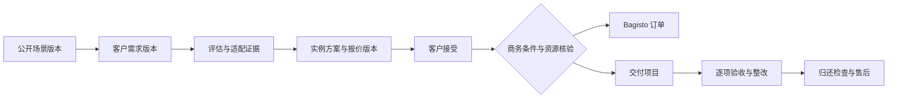

# 场景方案产品与工程实施方案

日期：2026-10-20。状态：实施前设计。适用对象：产品、前后端、测试、交付运营、内容运营和运维负责人。事实基线见[现状审计](Scene-Current-Audit.md)；逐包交付及测试见[任务矩阵](Scene-Backlog-Acceptance.md)。本方案中的新增表、服务、接口和页面均为拟建，不能当成已有能力。

场景方案要成为平台的服务产品：能明确服务目标与边界，采集客户现场条件，组合真实机器人、技能、配件和人工服务，形成可审阅报价，确认资源与档期，留下交付、验收和售后事实。质量标准是任何一笔业务都能回答“依据哪个版本承诺了什么、谁判断能做、报价怎么算、哪批资源负责、如何证明完成、失败由谁处理”。

## 1 范围和建设顺序

沿用 uni-app Options API、Laravel/Bagisto 模块化单体、配置注册表和现有 database 队列。设备归属仍以 `device_binding` 为准；订单仍用现有六类；技能继续买断及既有授权、交付、安全责任和售后规则；`app` 与 manual 的既有等价关系不改。场景订单不直接触发设备指令，现场调度也不替代厂商 SDK。

| 阶段 | 可交付业务 | 必须达到的准入条件 |
|---|---|---|
| SC0 真实性修复 | 可信展示与真实提交状态 | 停用撤销一致；示例不能下单；明确错误和空态；Admin 写动作鉴权；敏感日志收敛 |
| SC1 发布与需求受理 | 运营可发布，客户可提交、补充和查进度 | 发布版本不可变；真实需求号；负责人和受理事实；附件私有；旧入口接入统一服务 |
| SC2 评估与方案报价 | 工程师能按现场条件形成可解释方案 | 结构化现场调查；硬约束；BOM；版本化报价、审阅与客户接受；保存依据 |
| SC3 资源与交易 | 有依据地确认履约资源及订单 | 真实资源台账；时间与缓冲；并发占用；服务端核价；幂等建单；故障无半成品 |
| SC4 交付与售后 | 一笔方案按约交付并留证 | 任务、安装/现场记录、客户验收、归还检查、变更及售后；异常可处置 |
| SC5 规模化运营 | 运营能处理积压、失约和质量问题 | 工作台、指标口径、SLO、恢复演练、灰度开关及三端验收 |

SC 是本专项顺序，不重新定义项目 M1–M4。SC0、SC1 不等待微信支付或真机 Agent；SC2 支持人工调查和报价；SC3 先支持已审核的线下商务确认，不宣称在线支付完成。真机自动执行、厂商授权集成、全球伙伴调度等仅在外部前提满足后另行准入，不列近期必交任务。

场景服务的折扣、押金、取消、赔偿、验收窗口、服务时长、响应时间由产品与交付负责人冻结；方案给出建模方式，不擅自替平台定商业政策。第三方开发者继续使用既有独立门户；本期不新建服务商结算、提现、团队 RBAC 或合作方 SaaS 门户。

## 2 场景目录与可交付边界

保留现有 9 类 28 项 ID，停止按固定 ID 套本地能力。分类服务于发现，能力、供给和交付资格分别判断。

| 现有类别 | 标准需求模块 | 首期可承接方式 | 专项前提 |
|---|---|---|---|
| 商业活动 1–5 | 活动时段、观众/场地、表演及互动脚本、频次、驻场人员、运输搭建 | 经核验的标准租用组合或人工定制 | 现场边界、急停责任人、彩排及替补方案；不把引流提升写成保证 |
| 企业商用 6–9 | 接待流程、语言、知识库、访客数据、路线、楼层及网络 | 单点试点后扩大 | 电梯/门禁/业务系统逐项调查，未集成不能声称可跨层或自动访客登记 |
| 文旅 10–12 | 开放时段、客流、路线、天气、内容授权、驻场安排 | 短期活动或经审阅的驻场服务 | 复杂人流/室外/夜间单独核验；长期服务合同期限不变成技能订阅 |
| 教育 13–16 | 年龄段、班级、课程、师生比、设备数量、拍摄授权 | 有讲师的体验/课程或赛事服务需求 | 内容与操作边界由交付方确认；赛事报名引用赛事系统，不复制报名表 |
| 巡检 17–20 | 检查对象、点位、路线、频次、载荷、通信和异常处理 | 工程勘察、POC、验收后再运营 | 特殊环境资质/防护/现场批准逐项确认；无证据不以样机演示替代生产巡检 |
| 仓储物流 21–22 | 货物规格、重量、节拍、通道、地面、站点、上下游接口 | 现场调查和分阶段集成项目 | 搬运、识别、抓取和分拣是不同能力；不能从移动底盘推导全流程分拣 |
| 工业现场 23–24 | 演示与生产任务分流，工装、节拍、质量和安全区 | 展示可评估标准包；生产能力走集成评估 | “产线演示”不继承焊接/装配等生产能力；质量指标需现场验收 |
| 医疗康养 25–26 | 导览/互动与诊疗分流，人群、路线、联系人和数据边界 | 导览互动需求人工审阅 | 不把陪伴推导为诊疗或紧急救助能力；未知能力不能用“全天守护”等文案补齐 |
| 家庭个人 27–28 | 实际用途、操作者、环境、设备/技能、交付方式 | 已验证体验供给或人工需求受理 | 无供给保持咨询；社区、DIY、照护等未来方向不伪装成已提供服务 |

每个服务包有独立 `offer_mode`：`rental_package` 标准租用、`solution_project` 定制项目、`consultation` 需求咨询、`display_only` 说明展示。上线批次由真实供给决定，不以分类数量决定。

兼容等级沿用 L1 可交付、L2 可适配、L3 仅展示。等级绑定具体版本、机型、能力、现场限制和有效证据，不能给整个品牌贴一个永久 L1。展示状态、兼容等级、交易资格、资源状态分别返回；L1 也可能因为无档期不能下单，L2 可以受理调查但不能标“直接交付”。

## 3 用户与运营的完整工作流

### 3.1 客户侧

1. 从首页、机器页、AI 或分享进入同一场景 ID；服务端返回当前公开版本和允许动作。
2. 查看服务范围、前置条件、排除项、适用机型/技能、交付物和验收方式。案例只展示获授权且已核验的公开片段。
3. 填写城市、具体时间、现场条件和业务目标；动态表单由发布的 schema 决定，允许“未知/待勘察”，不强填猜测。
4. 提交后得到真实需求号；在“我的需求”看到受理、待补信息和负责人。提交超时用相同幂等键查询/重试，不再伪造服务端收到。
5. 工程师形成带检查结果的适配评估；缺信息列出缺口，明确冲突说明理由与替代路径。
6. 客户比较同一需求的方案版本，看设备、技能、人工、运输和服务费用及假设；接受绑定的报价版本与条款，不把“查看过”视为接受。
7. 资源确认满足商务条件后建立关联订单和交付项目；客户看到已确认资源/待确认项、里程碑和需配合事项。
8. 交付期间查看任务、变更和异常；按冻结验收项逐项确认，失败有整改和复验；租赁业务还须归还与检查。
9. 售后从需求、项目或订单进入并带上下文；技能授权问题继续关联原 entitlement，现场服务问题关联项目及交付项。

### 3.2 平台侧

| 角色职责 | 待办输入 | 可执行动作 | 必须留下的结果 |
|---|---|---|---|
| 内容运营 | 草稿、证据待复核、过期能力 | 编辑、送审、撤下 | 发布内容版本及依据；不能直接审批自己的高风险能力声明 |
| 客服/需求受理 | 新需求、待补充、响应超时 | 接单、转派、补充信息、说明关闭原因 | 负责人、联系结果、下次动作、时间；不能改批准报价 |
| 方案工程师 | 需求版本、现场资料 | 调查、评估、生成方案/BOM、提出风险条件 | 逐项结论及证据；不能把 unknown 改成 pass 只为提交 |
| 商务审核人 | 方案和成本/报价 | 批准报价、退回、确认线下商务凭证 | 报价指纹、审核人、条款版本、确认来源 |
| 交付负责人 | 已确认项目和资源 | 排班、派工、检查、替换申请、暂停 | 里程碑证据、实际工时、问题及客户沟通记录 |
| 客户 | 自己的需求/方案/项目 | 补充、接受/拒绝、变更申请、验收、售后 | 身份、对象版本、时间及确认内容 |
| 运维/QA | 失败队列、审计与告警 | 重放、排障、停写、恢复验证 | 操作原因、事件 ID、结果；不直接改业务终态 |

这张表是动作职责，不要求新建组织/团队权限系统。首期基于现有 admin guard、ACL 和对象负责人范围授权；外部服务方资料由平台授权人员录入并标注来源，不能冒充外部服务方已登录确认。

## 4 四类核心对象与状态

| 对象 | 含义与事实源 | 不得混淆的边界 |
|---|---|---|
| 场景模板 `scenes` + revision | 平台可公开复用的服务定义 | 标题不是客户方案；修改模板不改历史承诺 |
| 客户需求 `scene_requests` + revision | 某个客户、现场、时段和目标 | 原始文字、结构化事实和 AI 推断分别存 |
| 实例方案/报价 `scene_proposals` + revision | 对需求的某次有条件承诺和价格 | 每次报价关联明确评估及 BOM；不拿客户端商品价当批准价 |
| 交付项目 `scene_projects` | 已确认方案的执行与验收 | 订单状态、款项状态、设备安装、项目验收分别存在 |

### 4.1 发布状态

`draft → in_review → approved → published → withdrawn`。发布当前 approved revision 的不可变快照；退回产生新草稿，批准后任何正文、BOM、指标或证据变化均形成新 revision。`scenes.active_revision_id` 与 published 状态在同一事务切换，计增 `public_seq`，记录 outbox。前台读取发布指针，不能只凭 revision.status 查询旧公开内容。

紧急停用设置场景 `operational_state=suspended`，立即禁止新交易命令。异步缓存清理不是守卫；详情、聚合、AI、分享等读取检查当前指针/可见性，交易入口从主库重查。已承诺项目保留历史快照并进入影响评估，不删除客户已接受条款。恢复需明确原因和新审核；旧任务不得覆盖更新的 public_seq。

### 4.2 需求与评估状态

需求：`draft → submitted → assessing ↔ needs_info → ready → closed`，另有 `cancelled`。ready 表示可继续方案讨论，不表示已成交；成交和项目进度由关联对象投影。客户改现场或日期形成新 request revision，使旧 assessment 失效，不能在原记录上覆盖。

评估：`pending → in_progress → completed / invalidated`；结论按每项检查输出 `pass / fail / unknown / not_applicable`。硬条件有 fail 则不能承诺；有 unknown 则只允许人工补查；“不适用”必须给规则依据。审核人不能删除失败项后发布。评估可售资格为确定性结果，AI 不拥有这个状态转换权限。

### 4.3 报价状态

`draft → in_review → approved → sent → accepted / declined / expired / superseded`。approved/sent 版本锁内容和金额指纹；客户接受必须提交 revision、terms_hash 及幂等键。期限以服务端时间为准；已 superseded 的旧链接不能接受。

accepted 仅表示客户接受报价。能否创建 confirmed 项目还需资源确认及该报价冻结的商务条件满足。接受后改时间、数量、技能、地址或价格必须新方案/变更单并重新确认，不能覆盖已接受版本。

`valid_until` 是接受报价的截止时间；已经有效接受的价格快照不因后来过了这个时间就被改写。需要限制商务确认/资源确认时间的，另设 `confirmation_deadline` 并在接受前告知。超过确认期转人工处置或协商新版，不抹除原接受事实。普通场景文案更新不自动废除已接受报价；安全停用、撤供或适配证据失效则触发影响评估和客户沟通，不能静默履行失效承诺。

### 4.4 资源与交付状态

资源预留：`held → confirmed → released / completed`，held 可 `expired`。资源预留时间与报价有效期分别表达；报价有效不等于锁住档期。过期 held 在查询中立即不占容量，不能等定时任务释放后才可用。

项目：`planned → preparing → on_site → operating → acceptance_pending → accepted → closing → closed`；可进入 `paused / cancelled`，暂停记录来源状态、原因、责任人和恢复条件。不同服务包允许省略的节点由发布工作流定义，不能前端自由跳状态。

租用项目 accepted 后仍须归还、外观/部件核对、损坏争议和应退押金处理，closing 不等于款项全部结清；closed 只在冻结的完成条件满足后进入。退款、争议和事故各有状态，不靠把项目改成“已完成”来掩盖。

## 5 数据模型与约束

以下表名是建议契约。开发前核对实际库、PK 类型、MySQL 版本、字符集和存量重复数据；沿用项目时间和命名规范，不把未执行迁移列为已实现。

| 阶段及拟建表 | 关键字段 | 关键约束和索引 |
|---|---|---|
| SC1 扩展 `scenes` | active_revision_id、publication_state、operational_state、public_seq、row_version | 保留 ID/category/status；active revision 必须属于本场景；公开排序 `(status,sort,id)`，按实际执行计划确认 |
| SC1 `scene_revisions` | scene_id、revision_no、schema_version、content、requirement_schema、constraints、deliverables、acceptance_template、workflow、content_hash、审核/发布时间 | unique(scene_id,revision_no)；批准版本不可变；JSON 使用版本化 schema，限制层数、大小、数组项数和字段 |
| SC1 `scene_revision_items` | revision_id、line_no、component_type、product_id、device_model_id、skill_version_id、skill_asset_id/hash、service_code、qty、unit、required、替代组 | unique(revision_id,line_no)；真实目录引用；技能产物必须与版本及指纹一致；不能把不同产品 ID 当同机型 |
| SC1 `scene_evidence` | kind、source_ref、scope、observed_at、valid_until、result、reviewer_id、public_summary、rights_status、附件引用、hash、supersedes_id | `(kind,valid_until)`；不重复技能原有证据事实；引用其 ID/hash；撤销及过期使相关承诺待复核 |
| SC1 `scene_revision_evidence` | revision_id、claim_key、evidence_id、适用机型/条件 | unique(revision_id,claim_key,evidence_id)；每个量化声明有独立依据 |
| SC1 `scene_requests` | request_no、customer_id 或 guest_access_hash、scene_id、latest_revision_id、state、assignee_id、row_version、channel、consent_version | unique(request_no)；所有权不可由请求随意传入；`(assignee_id,state,created_at)`；contact 与业务事件分离 |
| SC1 `scene_request_revisions` | request_id、revision_no、scene_revision_id、raw_demand、facts、unknown_fields、site_timezone、starts_at/ends_at、source、hash | unique(request_id,revision_no)；时间 ends>starts；最新结构化数据不覆盖原始输入；限制原文长度并在 UI 明示 |
| SC1 `scene_attachments` | owner_type/id、storage_key、content_hash、mime、size、visibility、scan_state、uploader、retention_until | 随机存储名；私有盘；不返回 storage_key；父对象权限与附件状态共同授权 |
| SC1 `scene_activity_events` | aggregate_type/id、event_type、actor、audience、public_payload、correlation_id、occurred_at | `(aggregate_type,aggregate_id,id)`；追加记录；客户时间线只读允许字段，不直接返回 operation_log |
| SC2 `scene_assessments` | request_revision_id、scene_revision_id、ruleset_version、checks、snapshot_refs、result、reviewed_by、valid_until、invalidated_at | 把输入指纹钉住；最终结论需 reviewer；`(request_revision_id,created_at)`；不得使用 latest 推断历史 |
| SC2 `scene_proposals` | request_id、current_revision_id、state、row_version | 同需求可有备选；当前版本指针与状态同事务维护 |
| SC2 `scene_proposal_revisions` | proposal_id、revision_no、assessment_id、BOM/条款/验收快照、currency、subtotal/tax/discount/total/deposit_minor、valid_until、content_hash、approval | unique(proposal_id,revision_no)；币种及含税语义冻结；已审不可改；签署/接受绑定此 ID/hash |
| SC2 `scene_quote_lines` | proposal_revision_id、line_no、product/service_ref、component_type、qty、billable_units、unit_price_minor、discount/tax/total_minor | unique(revision_id,line_no)；分项合计等于表头；金额用最小货币单位，不用二进制浮点计算 |
| SC2 `scene_acceptances` | subject_type/id、revision_id、content_hash、actor_type/id、method、accepted_at、evidence_id | unique(subject_type,revision_id,actor_type,actor_id,method)；客户自认与平台代录线下凭证区别标识 |
| SC3 `scene_resources` | kind(robot/operator/accessory)、product_id/model_id、binding_id 可空、external_ref、city、timezone、capacity、state、capability_refs、verified_at | 每个可占资源有稳定主记录；物理机器人容量=1；外部供给数量不明不开放即时确认；binding 仅引用 |
| SC3 `scene_resource_reservations` | resource_id、proposal_revision_id/project_id、starts_at/ends_at、qty、state、expires_at、hold_token_hash | `(resource_id,state,starts_at,ends_at)`；同一物理资源无重叠；锁资源父行，不能只锁尚不存在的预留行 |
| SC3 `scene_order_links` | proposal_revision_id、order_id、project_id、conversion_state、snapshot_hash | unique(proposal_revision_id)、unique(order_id)；跨币种不混单；order_items.additional 保存 scene/quote/line/period 快照 |
| SC3 `scene_projects` 基础，SC4 扩展履约 | accepted_revision_id、request_id、owner_id、state、site、schedule、row_version、commercial_confirmation_refs | SC3 转换时已有基础表；冻结来源；`(owner_id,state,starts_at)`；不能通过客户端设置 accepted 或 paid |
| SC4 `scene_project_tasks` | project_id、task_key、dependency_keys、assignee、state、due_at、checklist、actual_start/end、evidence_refs | unique(project_id,task_key)；无环依赖校验；前置任务未完成不能执行受限节点 |
| SC4 `scene_change_requests` | project_id、base_revision/hash、reason、scope/schedule/price_delta、approval、customer_acceptance、state | 批准后追加补充快照和资源差量；不能覆盖原始报价；重复执行幂等 |
| SC4 `scene_acceptance_items` | project_id、criterion_key、attempt_no、source_revision、method、target、actual、result、evidence_refs、customer_ack | unique(project_id,criterion_key,attempt_no)；复验追加；自报、人工记录、设备实测来源分开 |
| SC4 `scene_service_cases` | project_id/order_item_id、kind、reason、state、assignee、requested_resolution、resolution、refund_request_ref | 整套服务售后独立于技能 entitlement；退款引用既有支付退款域或人工凭证，不能由售后状态伪造退款完成 |
| SC1 公共 `business_outbox` | event_id、aggregate_type/id、aggregate_seq、event_type、schema_version、payload、attempts、available_at、lease_until、processed_at | unique(event_id)；消费者幂等键另建 unique(consumer,event_id)；发布/受理/报价等事件与主记录同事务 |
| SC1 公共 `business_idempotency_keys` | principal_scope、operation、key_hash、request_hash、state、result_ref、expires_at | unique(principal_scope,operation,key_hash)；同键不同请求 409；进行中不重复执行；到期前后都靠业务唯一约束兜底 |

outbox 和幂等表应与生态专项共用：先查是否已有等价实现，存在则扩展，不重复造 `scene_outbox`。媒体可复用已落地的受控附件服务；只有 public 图盘不能满足现场资料权限。表数量服务于数据约束，若组合实现仍能保证不可变、索引和对象权限，可在评审后合并；不得把全部状态塞进一个任意 JSON 避开约束。

关系型字段使用真实外键或等效受控引用校验；多态目标无法直接 FK 的，使用类型允许列表、应用校验和定期孤儿扫描。禁止级联删除已接受版本、订单关联、验收、审计和事故引用；展示侧撤下与历史保留分开。

### 5.1 需求字段和表单版本

公共必填：scene_id/revision、城市、意向服务时间或明确待定、目标、联系人、联系授权。地址与精确定位按受理阶段渐进采集，不在公开详情或分析事件携带。

现场 schema 区分数值/单位/范围、单多选、日期、附件、未知原因；字段有 stable key、required_when、visibility 和适用阶段，不能下发任意 JavaScript 表达式。服务端校验为权威，前端同步规则用于反馈；schema 更新后已提交需求仍读原版，迁移需显式对照和客户补充。

用户事实 `customer_reported`、工程师实勘 `survey_verified`、设备观测 `device_observed`、AI 提取 `ai_inferred` 分开；AI 只能写待确认草稿。电话长度/格式、字符串长度、城市编码、数量上限和附件约束均在 FormRequest，未知值保留 null，禁止用 0 冒充。

### 5.2 指标和案例

每个指标保存定义、单位、样本、时间范围、环境、基线、计算方法、证据和审核人；区分 case_measured、vendor_claim、estimate。估算展示可编辑假设和计算式，不能以“实验室推算”一句话替代数据来源。净收益不为正时不输出回本月份。

案例的客户名、照片、视频和商标发布需有明确授权范围及有效期；可发布摘要与私有交付凭证分开。案例撤销不删除原验收，公开端立即不再读取；没有可发布案例则隐藏区域，不用三个固定图片故事填满。

## 6 服务分层和确定性判断

新增服务置于 `my-bagisto-store/packages/Webkul/Shop/src/Services/Scenes/`，前端 API 仍唯一进入 `utils/api.js`。Controller 负责鉴权、验证和响应，状态转换/事务在服务内。

| 拟服务 | 输入与职责 | 必须复用或验证 |
|---|---|---|
| ScenePublicationService | 草稿、审阅、发布指针、停用与公开 DTO | Admin ACL、受控媒体、OperationLogger::logOrFail |
| SceneRequestService | 提交、补充、分派、关闭、所有权和访问凭证 | customer guard 与明确的游客访问能力；旧入口适配 |
| SceneAssessmentService | 现场 schema + 需求 revision + 规则注册表 → 检查项、结论、有效期 | 复用技能兼容和资产解析，补场景能力及现场证据，不复制 SDK |
| SceneProposalService | BOM、快照、成本/报价、审阅、接受及版本失效 | 金额精度、条款/hash、不可变批准版本 |
| SceneReservationService | 区间、资源组、数量 → 查询/暂留/确认/释放 | 稳定父行锁、多资源锁序、过期查询语义 |
| SceneOrderConversionService | 已接受报价 + 商务条件 + 资源 → 订单及关联项目 | Bagisto 仓储事务行为必须实测；行映射和幂等 |
| SceneProjectService | 冻结模板展开任务、派工、变更、验收、归还 | 既有工单/事故/技能交付，仅在权限允许时调用 |
| SceneOperationsService | 逾期、告警、指标和持久补偿 | 现有通知/告警、outbox 消费及实际运行状态 |

评估按顺序执行：信息完整性 → 场地/环境硬条件 → 机型及载荷能力 → 技能版本及产物适配 → 地区/服务方/人员能力 → 资源时间 → 商务条件 → 人工审核。排序只发生在硬筛选之后，词命中和模型推荐都不能跳过硬条件。

每项输出 `rule_code / input_ref / observed / required / result / reason_code / evidence_refs / checked_at / valid_until / reviewer`。商品下架、技能熔断/撤版、产物 hash 改变、资源维修、现场或日期变化会触发失效及复评。对已签项目产生处置任务，不能悄悄换另一台机器人继续沿用旧证据。

## 7 报价 资源和订单的一致性

### 7.1 服务端核价

报价行包括机器人租用/购买、配件、技能买断、工程师、运输、勘察/部署、内容定制、培训和运维服务；哪些收费由服务包决定。必要和选配分开，替代项互斥，数量和单位显式表达。技能价格与授权继续按既有规则，折扣不能绕过技能域规定。

计算使用整数 minor units 或项目已验证的十进制定点工具，数量和计费单位先验证再乘，设置整单上限。费用区分收入、税、折扣和押金；押金不计收入。优惠按稳定规则分摊，尾差用确定性算法，退款不超原行可退余额。含税/未税、税率来源和汇率如适用均冻结，不硬编码一个全国统一税率。

“一天”到底是工作日、24 小时还是活动班次必须在 price_policy 中明确定义；额外工时、晚归、运输缓冲不能从日期文本推算。展示预估与已审报价分开；前端传任何 `price` 均不能修改已批准场景报价。报价缺服务费配置应报 `QUOTE_INCOMPLETE`，不能把缺失值变成免费。

### 7.2 档期及并发

时间用 ISO 8601 带 offset 输入，服务地点存 IANA timezone；新表按明确的 UTC 约定持久化，接口回原场地时区。历史订单时区未知不盲目转换；不全局修改现有 app 时区。

占用采用半开区间 `[starts_at, ends_at)`，机器人占用包含出库准备、运输、布场/彩排、服务、撤场、返程、检测维护；客户计费区间另存。资源可按真实机器人、工程师或配件占用；物理机器人容量 1，人员工时不能仅按“台数”算。

持锁顺序：业务幂等行 → proposal 行 → 资源父行按 ID 升序 → 必要的订单关联行。先锁所有候选稳定父行，再使用当前读查询有效重叠预留：`existing.starts_at < requested.ends_at AND existing.ends_at > requested.starts_at`，held 还必须 expires_at>now。不能依赖“查询空预留表”的行锁，也不能靠 unique(resource_id,start,end) 防止部分重叠。

确定第一批真实资源后，SC3 首先支持逐台分配；暂不支持无上限的“供给池数量”。若后续引入容量池，必须按所有区间边界计算峰值并锁父池，不用简单累加整段所有相交订单数量。死锁仅有限次重试且必须重新读取事实，不能缓存旧评估继续执行。

### 7.3 报价接受和订单转换

客户接受报价事务仅写 acceptance 和报价状态，不把未满足的商务条件显示为“资源已确认”。随后统一确认命令在同一主库事务中：检查当前场景守卫/版本 → 重新核验接受与评估 → 核验已冻结的商务条件 → 锁并验证预留 → 唯一创建订单关联与项目 → 确认资源 → 写强审计/outbox。失败全部回滚，网络通知不在事务内执行。

SC3 准入前必须通过现有 `OrderRepository` 嵌套事务与递归重试的故障测试，证明其不会提前提交、吞掉失败或遗留部分订单。未通过时，只开放需求、报价和人工待确认，不开放自动转换；修复限定在已评审的事务适配范围并回归原有订单类型，不能声称加一个外层 transaction 就已保证原子性。

对确认时已过期的 hold：重新锁资源复核并尝试新预留，失败返回冲突及替代日期；不撤销“客户已接受”的事实，也不谎称已占资源。订单构造中真实商品行及人工服务行映射到已配置、可建单的 SKU；缺服务 SKU 时 preflight 阻断，不能运行时偷偷创建锚点商品。`scene_order_links` 保证一个报价转换最多一个订单，重复请求返回同一结果。

场景组合可以包含技能。初期若不能证明技能付款/授权时序和整套项目的一致性，技能项从场景订单拆为关联技能订单，并向用户显示多个单号及各自状态；不改变既有 entitlement 触发条件，也不在服务费已确认时自动开通未满足条件的技能。拆单规则作为 SC3 契约验收项。

### 7.4 旧接口的绕过防护

新增接口不能只校验新页面。SC3 切换时，对场景来源 `from=scene`、`type=plan`、绑定场景报价的请求统一进入转换服务；拒绝靠删 from、改 type 绕过场景资格。普通租赁与场景项目在服务端有明确产品/报价类型，不依赖客户端来源标签鉴别。

旧客户端无 quote_revision 的场景请求应返回可恢复的 `SCENE_QUOTE_REQUIRED` 并导向需求/报价流程；不能静默建立同类未核价订单。既有普通租/买议价语义先保留，产品边界及校验映射经兼容评审后启用。SC0 先阻止示例和失效场景进入交易，不提前改变全局价格规则。

## 8 API 和错误契约

保留 `/api/scenes` 和 `/{id}` 的基础字段，补 `schema_version / revision_id / public_seq / offer_mode / compatibility_level / allowed_actions / eligibility_reasons / evidence_summary`。旧 `scheme` 由发布 DTO 投影；先验证现有消费者再决定弃用日期。缺失/撤下采用统一 404 对外策略，内部审计保存区别；非法 ID 稳定返回 4xx，不能 TypeError 500。

| 拟接口 | 主体与关键输入 | 结果及守卫 |
|---|---|---|
| GET `/api/scenes` | 公开；category/city/offer_mode/cursor/limit | 仅当前公开版本，limit≤50，稳定 sort+id，区别 empty 与 error；不返回私有证据 |
| GET `/api/scenes/{id}` | 公开 ID | 同一可见性服务；公开能力与缺口，不枚举草稿 |
| POST `/api/scene-requests` | 登录或允许的游客；scene revision、facts、raw_demand、consent、幂等键 | 返回 request_no、state、允许动作；数据上限、版本过期与防滥用 |
| GET/PATCH `/api/scene-requests/{id}` | 对象所有者；PATCH 带 If-Match/row_version | 查看允许字段或追加新 revision；过期写 409；PATCH 不改变所有权 |
| POST `/api/scene-requests/{id}/claim` | 已登录及原需求有效的一次性能力 | 绑定所有权，轮换游客能力、记录 claim；不能按手机号字符串认领 |
| GET `/api/scene-requests/{id}/proposals` | 所有者 | 仅已发送版本，内部成本和人员备注不透出 |
| POST `/api/scene-proposals/{id}/accept` | 所有者；revision/hash/terms/幂等键 | 保留接受事实；过期/改版 409/410，不自动声称资源和收款成功 |
| POST `/api/scene-proposals/{id}/confirm-order` | 明确授权的确认主体；报价+商务凭证+幂等键 | 锁资源并转换；资源冲突 409；未满足条件 422；无权不能代确认 |
| GET `/api/scene-projects/{id}` | 所有者或被分配平台人员 | 客户 DTO 与内部 DTO 分开，含里程碑及待配合事项 |
| POST `/api/scene-projects/{id}/changes` | 所有者/授权人员；base revision、变更内容 | 建变更请求；审批和接受后才生效 |
| POST `/api/scene-projects/{id}/acceptance` | 所有者；criterion/result/evidence/hash | 不许越过待验收状态；失败项进入整改；平台代录必须标注 |
| POST `/api/scene-projects/{id}/service-cases` | 所有者；问题及交付项 | 真实售后号，可查询进度；设备事故关联既有 incident |
| POST/GET `/api/scene-attachments/...` | 父对象所有者/授权人员 | 短时下载，签名绑定用户及对象；扫描未通过不可引用 |
| Admin 场景/需求/评估/报价/资源/项目动作 | admin guard + 每动作 ACL + 对象范围 | 发布、调价、替换、停用、验收更正、敏感导出分别授权；不只隐藏按钮 |

响应沿用项目错误信封，补 request_id 和稳定 code；敏感内部异常不通过 `e->getMessage()` 直接返回。预期业务错误示例：`SCENE_UNAVAILABLE / REVISION_CHANGED / REQUIREMENTS_INCOMPLETE / CAPABILITY_UNVERIFIED / CAPABILITY_CONFLICT / QUOTE_EXPIRED / QUOTE_INCOMPLETE / RESOURCE_CONFLICT / COMMERCIAL_CONFIRMATION_REQUIRED / IDEMPOTENCY_CONFLICT / SCENE_QUOTE_REQUIRED`。

所有写操作校验 Idempotency-Key（建议上限 128 字符），作用域绑定登录客户或独立游客能力+operation；同键不同载荷 409。同键相同载荷若仍进行中，返回 409 `REQUEST_IN_PROGRESS` 和 Retry-After，完成后返回原业务对象。事务失败不缓存假成功；客户端超时重试与人工重试走同一条服务路径。

## 9 三端页面与异常体验

| 入口 | 改造内容 | 必测状态 |
|---|---|---|
| `pages/home/index.vue` 场景卡 | 公开发布 DTO；服务模式和真实可用性；隐藏无口径人数 | loading/empty/error/retry/停用；onLoad/onShow 顶级；接口变空移除旧卡 |
| `pages/robot/index.vue` 场景与自定义方案 | 同源筛选；后端草稿；选择数量和服务时段 | 未验证商品禁加入；草稿显示“仅本机”或“已保存到账号”；跨账号不串 |
| `pages/robot/fangan.vue` | 范围/条件/BOM/证据/案例/交付/FAQ；CTA 由 allowed_actions 驱动 | 展示、咨询、待适配、可报价、无档期、撤下、未知机型分别反馈 |
| `pages/home/rmfangan.vue` | 历史链接映射/重定向 | 无有效映射展示失效；不用 title 猜 ID，不再补随机机器人 |
| 拟 `pages/scene/request.vue` | 分步需求，服务端 schema，草稿与补充 | 字段错误定位；未知值；中断恢复；附件失败；schema 变更 |
| 拟 `pages/mine/scene-requests.vue` / `scene-request-detail.vue` | 我的需求、负责人、下一步、真实时间线 | 无权限、未受理、待补、撤销、分页；游客找回能力与登录迁移 |
| 拟 `pages/scene/proposal.vue` | 方案对比、费用和押金分列、版本变化、接受 | 有效期、旧版本、已接受、资源未确认、改价冲突；不自动勾选条款 |
| `pages/order/checkout.vue` | 场景模式只带 quote revision，服务端返回结算快照 | 改价、商品失效、资源冲突、重试、响应丢失；本地意向不显示后台已收到 |
| 拟 `pages/scene/project.vue` | 交付任务、配合事项、变更、验收、归还、售后 | 逾期、暂停、整改、复验、取消、线下记录与设备上报来源区分 |
| Admin 管理页 | 从场景列表延伸需求工作台、评估/报价、资源日历、项目任务 | 低权限直接 URL、表单保留、并发改版、审计失败、分页/导出 |

复用 `StateView`、现有 NavBar、配色和错误处理，适配 H5 与小程序，不靠整页静态兜底解决白屏。首页/详情只缓存经过 schema 校验的公开响应；缓存有版本和来源时间，清空/null/0 是有效新值。onShow 和进入详情时在线重验证；离线缓存只能提供标注时间的参考内容，不能提供当前可成交资格。停用的强约束由服务端交易命令即时重查保证，不能声称已经打开的离线页面会自动收到撤销。外部 CDN 图片 URL 只允许已配置域名，不把所有绝对地址强行改成本地地址。

## 10 权限 隐私和可靠性

游客可提交需求，但新需求的私有查询不只凭公共编号或本机 X-Guest-Key。服务端生成高熵访问能力，仅保存 hash，绑定需求与用途；前端安全存储，不放 URL、分析事件或日志；支持撤销、过期和登录认领。恢复凭证按现有可用身份能力处理，不能为赶进度伪造短信验证。游客不具备可信接受身份时先受理，接受报价前引导登录或受控线下确认。

Admin ACL 对每个 HTTP 动作显式映射，未映射默认拒绝本模块操作。需求/项目按负责人或授权范围隔离；查看联系人、下载现场附件、看内部成本、批量导出分权。DataGrid 的参数导出也受相同权限与范围约束。客户永远不能通过 ID 改写他人对象。

上传采用 MIME/扩展名/文件头综合校验、大小和数量限制、恶意文件扫描；本期先限制受支持的图片/PDF，其他格式明确拒绝。图片去除不必要 EXIF；私有资料不能落公开 storage URL。外链不自动抓取；如后续实现抓取，需独立 SSRF/重定向/域名策略。资料保留期由用途配置，到期清理和争议保全有明确事件，清理不能删事故保全证据。

outbox 主记录同事务，消费者允许至少一次投递；按 event_id 幂等，短租约、有界重试、失败队列和可审计重放。外部通知不保证恰好一次，重复消息不得重复建单、扣款、派工或改变资源。关键状态即时由主库守卫，worker 挂了只影响提醒/投影，不允许过期报价或失效资源继续被接受。

操作审计留 actor、对象、before/after hash、原因、correlation_id；敏感正文不入日志。报价批准、订单确认、验收更正和资源替换需要强审计，失败则整个命令回滚。客户通知须经 audience 过滤，不能把内部审计 JSON 原样发出。

## 11 可运营的交付样板

### 11.1 展会互动两日服务

示例需求：上海展馆，两台已验证机器人，两日指定活动时段，迎宾与定时互动。仅为流程样板，不代表当前有这批资源。

| 环节 | 必须产生的工程对象 | 失败分支 |
|---|---|---|
| 需求 | 场地、日期/时段、地面/人流、脚本、频次、驻场、运输与联系人 revision | 不确定尺寸/安全区则待补或实勘 |
| 评估 | 两机型+所需技能产物证据、连续运行及充电安排、工程师能力、急停负责人 | 某技能只仿真验证则不标 L1，转人工验证或改服务范围 |
| 报价 | 2 台×2 计费日、驻场班次、往返运输、布场/彩排、内容、押金分项；租期与占用分别存 | 缺工程师/运输费用不能报免费；客户删服务项触发重新审核 |
| 资源 | 两个具体资源 ID、工程师、运输缓冲及替补条件 | 同时第二个客户抢档期只允许一方确认；另一方替代日期 |
| 交付 | 出库检查→到场→彩排→每日服务→客户验收→撤场→返库检查 | 延迟、故障、临时替机都建异常/变更，不能静默标完成 |
| 验收 | 按已约定时段/任务/次数的记录、客户确认及未完成项 | 以实际任务完成衡量，不用“引流提升 200%”替代服务履行 |

### 11.2 单层展厅导览试点

需求定义路线、点位、讲解内容/语言、开放时段、网络及客户知识库。先调查通道与人工接管，在冻结路线进行试运行，记录每次任务完成/失败、干预原因和内容正确性。验收阈值在报价前双方确认，不能事后降低。电梯或门禁没有授权适配证据时，从交付范围排除并说明；试点验收后，增加楼层必须新评估和新变更版本。

### 11.3 仓库搬运与分拣需求

先分开移动、货物识别、抓取/分拣、站点交接及 WMS 对接；采集重量、形状、节拍、地面、通道、峰值、接口、异常和人工作业基线。输出可行性/POC/规模化三个阶段交付与各自退出条件。单纯可租底盘不产生完整分拣能力；某接口未知只允许调查/POC，不开放“立即下单交付整套仓储自动化”。

首批运行选择有实物、有负责人、有依据的活动服务和单点导览，形成可审计流程；不按“28 个场景全部上架”验收。工业/巡检/医疗等类别可保留真实咨询入口，交易资格由实际评估决定。

## 12 指标 SLO 和运营工作台

| 指标 | 数据口径 | 禁止替代 |
|---|---|---|
| 有效需求数 | 已提交且非测试/非重复/非撤销，按 request_id 和时间窗 | 表单打开次数或手改咨询数 |
| 首次受理时间 | submitted_at 到首次有责任人的人工受理，按已配置工作日历 | 自动发送通知当人工联系 |
| 报价转化 | 已接受的有效报价/已发送有效报价，按需求去重并排除 superseded | 所有零元 custom 单当交易 |
| 资源利用 | 已确认/实际占用时段与可服务时段，标明维护和运输口径 | 商品库存数量当在线机器人 |
| 按时交付率 | 冻结承诺时间与实际里程碑，批准变更单另列 | 修改原计划后把延迟消掉 |
| 首次验收通过率 | 首次提交验收中通过的项目/已验收项目 | 平台代录都算客户自动确认 |
| 客户问题与事故 | 售后、整改、incident 独立统计并关联项目 | 只展示平均评分 |
| 业务健康 | outbox 最老未处理、失败率、队列滞后、无负责人/逾期任务 | HTTP 200 当业务成功 |

建议待环境基线确认后冻结：公开读取 p95≤800ms、需求写入 p95≤1.5s（不含上传和外部 AI）、常规 outbox 端到端≤60s；这些是候选验收目标，未测得的当前性能。压测按约定数据量和并发执行，不用本机 `php artisan serve` 冒充生产容量。真实性、无越权、并发不超配和金额一致属于硬门槛，不能由平均延迟抵消。

工作台每个数字能进入对象列表并采取动作：待受理、待补资料、待工程审核、报价临期、资源冲突、临近到场、未上传检查、逾期验收、售后未分派、通知失败、证据待复核。每项显示负责人、下一步、截止时间和升级对象；无工作日历/负责人配置时不能对客户承诺一小时。

## 13 迁移 上线和回退

1. 只读 preflight：库版本/引擎/字段索引、scenes 状态、孤儿商品、旧静态 ID 冲突、历史 plan/custom 单、图片、ACL、旧客户端版本及实际队列运行。
2. 备份：业务库及文件做可恢复备份并记录恢复结果；风险代码备份至 `.claude/backup/scene-<批次>/`，不碰历史备份目录。
3. Expand：只加表/列和兼容读取，不删除旧字段；新功能开关默认关闭。若现存公共 outbox/幂等基础已落地先复用。
4. 回填：仅对数据库中实际存在的旧场景生成 legacy 草稿，不把本地 28 行自动当真实供给灌库；缺证据、案例、报价保持未验证。旧 consult_count 不回填成真实事件；robots ID 逐项对照，不自动认定适配；SceneSeeder 改为缺失插入。
5. 历史订单仅建可证明的关联，不能按相似名称认领；零元线索留在原表做 legacy 记录，可人工核验转换需求并留映射，不能批量自动成交。
6. 影子读取和差异报告：新旧 DTO 对比，不影响用户；审核后逐场景启用新发布，再启用需求，最后在 SC3 验收后开启报价转换与资源确认。
7. 建议分开关：scene_publication_v2、scene_requests_enabled、scene_quote_acceptance_enabled、scene_order_conversion_enabled、scene_project_actions_enabled。每个写开关同时守卫新 API、Admin 和旧入口；公开读取撤销不靠关闭写开关替代。
8. 灰度先一个可交付场景和一组真实资源，完成含失败分支的人工通道演练，再扩大；真机自动通道另行验收。
9. 回退先停对应写入口并保留私有需求/已接受方案的受控只读查询，清理公开缓存、停止不兼容消费者，回到兼容代码；已有新需求和订单后禁止 down 丢表。临时 held 按策略释放，confirmed 资源不能因回退自动撤销。恢复后按幂等事件补偿。

外部支付网关、真机 Agent、厂商接口和生产运维承接方均有独立前置条件，未具备时对应开关保持关闭；人工报价与人工交付仍要完成自身数据、权限、证据和异常路径验收，不能用“外部依赖”解释内部缺陷。

## 14 官方实践与本项目的取舍

以下是本次查阅的官方一手资料。仅借鉴能力划分，不把厂商文档当成本项目已经具备的接口、资质或性能证明。

| 来源 | 可核对的实践 | 本方案采用的工程原则 |
|---|---|---|
| [Odoo 19 实体租赁产品](https://www.odoo.com/documentation/19.0/applications/sales/rental/products.html) | 区分价格周期、预留缓冲、实物追踪、交接与归还 | 计费周期与资源占用分开；交付后仍有归还检查；这些业务定义可借鉴，不替换 Bagisto |
| [Open-RMF rmf_task](https://github.com/open-rmf/rmf_task) | 任务由阶段/事件组成，考虑资源约束；执行实现由 fleet adapter 承担 | 平台服务任务先有依赖、结果和中断语义；实时机器人控制保持适配器边界，近期不引入 RMF |
| [InOrbit Mission Tracking 教程](https://developer.inorbit.ai/tutorials) | 先定义任务起止和任务数据来源，再建立任务视图和绩效 | 每项交付先定义何为完成、数据来自哪里；人工记录和设备观测分别标识 |
| [Formant Teleoperation](https://docs.formant.io/docs/advanced-teleoperation-introduction) | 实时操作会话与持久请求队列分别存在，并展示系统健康数据 | 实时执行、离线请求和人工履约各有状态；当前没有真机和遥测时不能造在线率/健康分数 |

上述原则是对官方资料的工程推导。近期建设优先解决可信服务目录、需求、评估、核价、资源确认和人工履约；自动调度只有获得真实设备能力和现场验收后才进入承诺范围。
