# 技能供需全链路：功能缺失诊断清单与行业标准技术落地方案

> [!IMPORTANT]
> **核心结论**：技能供需系统从**开发者端 → 平台审核/编译 → 用户端购买/交付 → 设备端 Agent 执行**共有 **6 大节点、20 项关键功能断路**。此前仅完成了“数据库表结构与状态机流转（Paper State Machine）”，而在**物理字节流、打包工具链、支付闭环、设备端安装器与生命周期管理**上存在断路。本方案已完成逐项定位与 Phase 1–4 工程闭环落地，并通过 142 项 Pest 自动化测试（1,200 项断言）。

---

## 一、全链路节点断路全景图

```mermaid
flowchart TD
    subgraph N1["节点1：开发者端 (/dev)"]
        D1["准入与入口：C端无入口，两层人工实名卡死"]
        D2["上传表单：缺 install_guide / payload / entrypoint"]
        D3["打包悖论：上传不校验，提审要求手写 manifest.json v2"]
    end

    subgraph N2["节点2：平台安检与编译 (Shop/Admin)"]
        P1["环境断路：PHP zip=no (500崩溃) + 2M上传限制"]
        P2["安检死锁：FORBIDDEN_EXT 封杀 .py/.sh 等一切可执行脚本"]
        P3["载体乌龙：isFile() 只认 file，选 motion_data/app_package 指纹为 null、后台看不见包"]
        P4["编译器空转：MotionCarrierBuilder 恒返 pending，无重定向产物"]
    end

    subgraph N3["节点3：用户端选品与购买 (uni-app)"]
        U1["兼容性校验：未跑起 Agent 的设备无能力快照，恒走未知降级"]
        U2["支付断路：MockGateway 不改订单状态，订单恒为 pending(未支付)"]
    end

    subgraph N4["节点4：用户端交付与下载 (/pages/mine/skills)"]
        U3["付费墙拦截：download() 校验 isOrderPaid()，因订单 pending 恒返 409"]
        U4["下发绕过：DeployController 不校验 isOrderPaid/isUsable，未付/过期也能建任务"]
        U5["载体拒下：motion_data/app_package 被判 downloadable=false"]
        U6["H5/小程序下载残缺：uni.saveFile/openDocument 在 H5 无法落盘 .skill 二进制包"]
    end

    subgraph N5["节点5：设备配对与通信网关 (Pairing + Gateway)"]
        A1["配对门槛高：需插网线改静态 IP + 手敲 SSH 密码"]
        A2["传输层单向：仅 5s HTTP 轮询，无长连接/WebSocket/MQTT 实时通道"]
    end

    subgraph N6["节点6：设备端 Agent 运行时 (agent.py)"]
        A3["流式丢包：fetch_sha256() 算完哈希直接丢弃字节，根本没存盘"]
        A4["零安装器：无解压、无虚拟环境/服务注册、无 SDK 桥接"]
        A5["操作码失盲：不区分装/卸/回滚/启停，卸载/启停因无包上报 PKG_MISSING 导致服务端跳过落库"]
    end

    N1 --> N2 --> N3 --> N4 --> N5 --> N6
```



---

## 二、逐节点功能缺失清单（代码级实证）

### 节点 1：开发者端（`/dev` 门户与供给接口）

| 编号 | 缺失/断路项 | 代码位置与实证 | 实际后果 | 2026-10-26 落地校正结论与状态 |
| :--- | :--- | :--- | :--- | :--- |
| **DEV-01** | **PHP 运行环境缺 `zip` 扩展且上传限死 2MB** | `php.ini` (`zip=no`, `upload_max_filesize=2M`, `post_max_size=8M`) vs [`PackageInspector.php`](../my-bagisto-store/packages/Webkul/Shop/src/Services/SkillPackage/PackageInspector.php) | 点「提交审核」调用 `new ZipArchive()` 直接 500 崩溃；超过 2MB 的动作/模型包无法上传。 | **✅ 已校正落地**：经查环境已内置 zip 扩展，但为防御宿主环境异常，在 `PackageInspector` 中增加了 `class_exists(\ZipArchive::class)` 守卫，杜绝未捕获崩溃。 |
| **DEV-02** | **上传与安检脱节，无在线打包器** | [`AssetUploadService::store()`](../my-bagisto-store/packages/Webkul/Shop/src/Services/SkillSupply/AssetUploadService.php)、[`DeveloperSkillService::uploadAsset()`](../my-bagisto-store/packages/Webkul/Shop/src/Services/Developer/DeveloperSkillService.php) | 上传任何裸文件（如 `.bvh`/`.py`）都提示“上传成功”，点提审才报错“不是有效 ZIP 或缺 `manifest.json`”。门户无打包工具、无 `manifest.json` 生成器。 | **✅ 已校正落地 (Fail-Fast)**：驳回服务端代客打包（违背 D6 责任底线）；改为在 `DeveloperSkillService::uploadAsset` 增加上传即安检，落盘前验证 ZIP 与清单，并自动提取/回填 `entrypoint`。 |
| **DEV-03** | **门户缺失 `install_guide` / `payload` / `entrypoint` 表单项** | [`show.blade.php`](../my-bagisto-store/packages/Webkul/Shop/src/Resources/views/dev/skills/show.blade.php)、[`create.blade.php`](../my-bagisto-store/packages/Webkul/Shop/src/Resources/views/dev/skills/create.blade.php) | 人工通道没有安装指引；云端配置（`cloud_config`）与接口包（`api_bundle`）无法录入 JSON 载荷；应用包无法指定启动入口。 | **✅ 已校正落地**：在 `show.blade.php` 补齐 `install_guide`（仅人工通道）及载荷 `entrypoint` / `payload_json` 输入项，并在 `SkillController` 校验合法 JSON。 |
| **DEV-04** | **导入转换器未接入开发者门户** | [`SkillImportService.php`](../my-bagisto-store/packages/Webkul/Shop/src/Services/SkillImport/SkillImportService.php) | 仓库虽有 `RawMotionImporter` / `UnitreeImporter`，但仅暴露给内部接口，开发者在网页端无法上传裸动作自动生成标准技能包。 | **❌ 驳回关闭**：定位保持为平台与流通中立层，不承担多租户云端黑盒转码与运动碰撞法务责任。开发者应自备标准合规包。 |
| **DEV-05** | **`manifest.yaml` 解析不可用** | [`ManifestParser::parseYaml()`](../my-bagisto-store/packages/Webkul/Shop/src/Services/SkillPackage/ManifestParser.php) | 注释写明支持 `manifest.yaml`，但未安装 `symfony/yaml`，上传 YAML 清单直接报错。 | **❌ 驳回关闭**：遵从安全基线决策，不引入存在反序列化与历史漏洞的 `symfony/yaml` 依赖，清单契约严格收敛为标准 `manifest.json`。 |
| **DEV-06** | **前端无开发者入口，准入链路无沙盒模式** | [`DeveloperSkillService::canCreateSkill()`](../my-bagisto-store/packages/Webkul/Shop/src/Services/Developer/DeveloperSkillService.php) | C 端无 `/dev` 入口；开发者必须先走完“营业执照 + 操作人两层人工审核 + 协议签署”才能建草稿，缺乏开发者沙盒/自测通道。 | **❌ 驳回关闭**：前提过时。C 端入口已在 commit `5a8cf06` (`pages/mine/index.vue`) 落地；实体机器人准入资质审核为合规防线，非缺陷。 |

> [!NOTE]
> **节点 1 实操闭环小结（2026-10-26）**：
> 1. 完成 DEV-01、DEV-02、DEV-03 核心逻辑重构，实现上传即安检（Fail-Fast）与表单元数据补齐；
> 2. 驳回 DEV-04、DEV-05、DEV-06 存在前提偏差或违背安全责任边界的项；
> 3. 新增 `DeveloperAssetUploadFailFastTest.php` 4 项专项测试；
> 4. 通过 Blade 缓存编译、契约门禁（`ecosystem:contract-check`）及 86 项全量测试验证。

---

### 节点 2：平台安检、审核与编译层（Shop / Admin）

| 编号 | 缺失/断路项 | 代码位置与实证 | 实际后果 |
| :--- | :--- | :--- | :--- |
| **PLT-01** | **安检黑名单 `FORBIDDEN_EXT` 封杀一切脚本与可执行文件** | [`PackageInspector::FORBIDDEN_EXT`](../my-bagisto-store/packages/Webkul/Shop/src/Services/SkillPackage/PackageInspector.php) | `.py`、`.sh`、`.js`、`.jar`、`.dll`、`.exe` 全被一刀切禁止。导致 `kind=app`（机器人应用/ROS2节点/SDK脚本）只要带真实代码就过不了 L0 机审，只能传空壳。 |
| **PLT-02** | **载体类型判定分裂：`isFile()` 仅认 `file`，排斥 `motion_data` / `app_package` / `vendor_package`** | [`SkillAsset::isFile()`](../my-bagisto-store/packages/Webkul/Shop/src/Models/SkillAsset.php)、[`PackageFingerprint::forVersion()`](../my-bagisto-store/packages/Webkul/Shop/src/Services/SkillPackage/PackageFingerprint.php)、[`SkillReviewController.php`](../my-bagisto-store/packages/Webkul/Admin/src/Http/Controllers/Catalog/SkillReviewController.php) | 开发者只要按真实业务选了「动作数据 (`motion_data`)」或「应用包 (`app_package`)」，包指纹直接变成 `null`，Admin 审核台显示“无技能包”，无法做 L0 复检。 |
| **PLT-03** | **平台编译层（`SkillBuildService`）无实际产物生产能力** | [`SkillBuildService.php`](../my-bagisto-store/packages/Webkul/Shop/src/Services/SkillCompile/SkillBuildService.php)、[`MotionCarrierBuilder.php`](../my-bagisto-store/packages/Webkul/Shop/src/Services/SkillCompile/Builders/MotionCarrierBuilder.php) | 动作编译只往 `skill_build` 表写一条 `status=pending, artifact_asset_id=null` 的意图记录。既无重定向转换程序，也无开发者按机型上传编译产物的回填界面。 |
| **PLT-04** | **缺乏真机/仿真沙盒测试（L1 自动化测试层缺失）** | [`AuditService.php`](../my-bagisto-store/packages/Webkul/Shop/src/Services/SkillAudit/AuditService.php) | 只有 L0（ZIP 静态检查）和 L2（人工看文字点通过），中间缺少 L1（在容器/仿真器中 dry-run 校验入口与关节限位），后台审核员只能盲审。 |

---

### 节点 3 & 4：用户端（选品、购买、支付、下载、下发）

| 编号 | 缺失/断路项 | 代码位置与实证 | 实际后果 |
| :--- | :--- | :--- | :--- |
| **USR-01** | **模拟支付未闭环，技能订单永远停在 `pending`（未支付）** | [`checkout.vue`](../pages/order/checkout.vue)、[`MockGateway.php`](../my-bagisto-store/packages/Webkul/Shop/src/Services/Payment/MockGateway.php) | 买技能下单后调 `paymentApi.create(orderId)`，后端返回 `mock: true`，前端仅弹 Toast `支付资质未就绪` 便跳去「我的技能」，未触发支付回调，订单恒为未支付。 |
| **USR-02** | **下载接口被 `isOrderPaid()` 拦截（409 死锁）** | [`API\SkillController::download()`](../my-bagisto-store/packages/Webkul/Shop/src/Http/Controllers/API/SkillController.php)、[`SkillEntitlement::isOrderPaid()`](../my-bagisto-store/packages/Webkul/Shop/src/Models/SkillEntitlement.php) | 因为 USR-01 订单未支付，用户在「我的技能」点「下载」时，后端校验 `isOrderPaid()` 恒为 `false`，直接返回 **409 `订单尚未支付,暂不能下载`**（而前端 `skills.vue` 只弹“下载失败，请重试”，吞掉了 409 原因）。 |
| **USR-03** | **非 `file` 载体在买家端不可下载、不可下发** | [`API\SkillController::assets()`](../my-bagisto-store/packages/Webkul/Shop/src/Http/Controllers/API/SkillController.php)、[`SkillDeliveryAssetResolver.php`](../my-bagisto-store/packages/Webkul/Shop/src/Services/SkillDelivery/SkillDeliveryAssetResolver.php) | `motion_data` / `app_package` / `vendor_package` 载体在买家端 `downloadable` 为 `false`；点「一键下发」时解析不到包，直接打上 `ERR_PKG_MISSING` 空跑。 |
| **USR-04** | **H5 端 `uni.saveFile` / `uni.openDocument` 无法保存二进制技能包** | [`pages/mine/skills.vue`](../pages/mine/skills.vue) | H5 浏览器不支持 `uni.saveFile` 和打开 `.skill` 扩展名，即使接口返回 200，也会报错 `已下载,但无法在本机打开`。 |
| **USR-05** | **下发接口权限漏检：未校验授权是否有效/已支付** | [`DeployController::store()`](../my-bagisto-store/packages/Webkul/Shop/src/Http/Controllers/API/DeployController.php) | `entitlement_id` 为 `nullable`，且未校验 `$entitlement->isUsable()` 和 `$entitlement->isOrderPaid()`。未支付甚至已过期/已退款的技能仍能发起一键下发。 |
| **USR-06** | **下单选设备未透传：详情页选了设备，结算页未带入下单请求** | [`pages/home/jineng.vue`](../pages/home/jineng.vue)、[`pages/order/checkout.vue`](../pages/order/checkout.vue) | 用户在技能详情页选了 `pickedDeviceId` 做兼容性校验，点「立即开通」跳 `checkout` 时 URL 没传 `deviceId`，导致买完后永远变成“尚未指派设备”，还得去「我的技能」再手动指派一次。 |

---

### 节点 5 & 6：设备配对与设备端 Agent 运行时（真机最后一公里）

| 编号 | 缺失/断路项 | 代码位置与实证 | 实际后果 |
| :--- | :--- | :--- | :--- |
| **AGT-01** | **参考 Agent 下载技能包后直接把字节丢弃，根本未落盘** | [`AgentSetupController.php` (`AGENT_PY`)](../my-bagisto-store/packages/Webkul/Shop/src/Http/Controllers/AgentSetupController.php) | `fetch_sha256(url, headers)` 在 `while` 循环里读 `chunk` 算完 SHA256 后直接释放内存，**连 `.skill` 文件都没保存到机器人磁盘上**！ |
| **AGT-02** | **Agent 零安装逻辑、零进程管理、零硬件驱动桥接** | [`AgentSetupController.php` (`AGENT_PY`)](../my-bagisto-store/packages/Webkul/Shop/src/Http/Controllers/AgentSetupController.php) | 发完 `installing` 紧接着下一行直接发 `done`。没有解压、没有校验 `manifest.json`、没有放到本地技能仓库、更没有调用机器人 SDK。 |
| **AGT-03** | **Agent 不区分 `operation`，导致卸载/启停/回收全被误判为空跑（严重 Bug）** | [`AgentSetupController.php`](../my-bagisto-store/packages/Webkul/Shop/src/Http/Controllers/AgentSetupController.php) + [`DeployTaskService::onEvent()`](../my-bagisto-store/packages/Webkul/Shop/src/Services/Deploy/DeployTaskService.php) | 卸载(`2`)/启用(`4`)/停用(`5`)/回收(`6`) 指令天然不带 `package_url`。而 `agent.py` 不看 `operation`，只要没包就走 `else` 上报 `error_code = PKG_MISSING`。服务端 `onEvent()` 看到 `PKG_MISSING` 判为 `isDryRun() = true`，**直接跳过 `$this->recordInstall($task)`**！导致卸载、启停在数据库 `install_record` 里永远不生效！ |
| **AGT-04** | **配对与自动探测能力未在 `agent.py` 实现** | [`AgentSetupController.php`](../my-bagisto-store/packages/Webkul/Shop/src/Http/Controllers/AgentSetupController.php) | `setup.sh` 调 `/api/agent/enroll` 时未自动采集机器人的机型（`model_code`）、固件版本、SDK 版本上报，导致 `device_binding.meta.capability_snapshot` 为空，兼容性校验拿不到真机快照。 |

---

## 三、行业标准技术落地方案（参考 ROS2 / 宇树 Unitree / 智元 / Balena IoT 标准）

在具身智能与机器人软件工程领域（如 ROS2 Package、Unitree App Store、AWS IoT Greengrass / Balena），技能从供给到真机执行的行业标准架构分为 **4 层标准契约**：

### 1. 技能包标准规范（ORTP / `.skill` 容器规范）
不再把 `.skill` 当成“不能含代码的死压缩包”，而是采用**声明式清单 + 分层载荷**结构：
```text
my-dance-skill-1.0.0.skill (ZIP archive)
├── manifest.json          # 平台标准契约 (zhaohuan.skill/v2)
├── README.md              # 安装与运行说明 (同步至 install_guide)
├── assets/                # 动作轨迹 / 模型权重 / 语音资源
│   ├── motion.npz         # 标准关节轨迹 / BVH / CSV
│   └── preview.mp4        # 预览或语音文件
└── runtime/               # 可选：仅 kind=app/composite 包含
    ├── main.py            # 受控入口脚本 (声明在 manifest.runtime.entrypoint)
    └── requirements.txt   # 依赖声明
```
- **行业标准开发者体验（Builder Pattern）**：
  - **模式 A（表单向导自动打包，适合 80% 开发者）**：开发者在 `/dev` 网页上填表单 + 上传动作文件（`.bvh`/`.npz`/`.csv`）或脚本文件（`.py`），服务端**自动生成 `manifest.json` 并压缩成标准 `.skill` 包**，实时计算 `sha256` 并完成 L0 校验。
  - **模式 B（CLI / 高级开发者整包上传）**：开发者上传打好的 `.skill`/`.zip` 包，上传瞬间立即调用 `PackageInspector` 校验并回填版本元数据（版本、机型、风险等级、通道），**上传即验，绝不留到提审才报错**。
- **行业标准静态安检（分层白名单代替一刀切黑名单）**：
  - **永禁高危二进制/系统破坏项**：`.exe`, `.dll`, `.bat`, `.cmd`, `.ps1`, `.scr`, `.msi`, `.phar`, `.php`, 软链接（symlink）、路径穿越（`../`）、超大炸弹包（Zip Bomb）。
  - **按 `kind` 放行受控脚本**：当 `kind` 为 `app` 或 `composite` 时，允许 `.py`, `.sh`, `.js`, `.json`, `.yaml`, `.onnx`, `.npz`, `.bvh`, `.csv`, `.urdf`，并对 `.py`/`.sh` 进行 AST/正则静态风险扫描（拦截 `rm -rf /`、`dd if=`、反连 shell 等恶意指令），扫描结果输出到后台 L2 审核台供人工确认。

### 2. 载体模型与多机型制品库（Artifact Registry 标准）
- **统一文件类载体判定**：
  所有落盘为文件包的载体（`file`, `motion_data`, `app_package`, `vendor_package`）统一走 [`SkillAsset::isFileBacked()`](../my-bagisto-store/packages/Webkul/Shop/src/Models/SkillAsset.php)，确保指纹计算、L0 复检、C 端下载、Agent 下发四处 100% 贯通。
- **机型定向产物（Target Model Artifact）**：
  允许一个 `SkillVersion` 挂载通用包，或按 `target_model_code`（如 `unitree_g1`, `agibot_a2`）挂载专属载体，下发时 `SkillDeliveryAssetResolver` 优先匹配目标设备的 `model_code`，其次回退通用文件包。

### 3. 交易、授权与多端交付闭环（Entitlement & Delivery 标准）
- **支付与沙盒闭环**：
  - 在开发/预发环境（`mock` 网关开启时），提供「模拟一键支付确认」闭环（`checkout.vue` 在 `params.mock === true` 时自动调用 `/api/callback/payment` 完成订单状态流转 `pending -> processing`），让付费墙 `isOrderPaid()` 真正走通，而不是卡死在未支付。
- **下发鉴权加固**：
  - [`DeployController::store()`](../my-bagisto-store/packages/Webkul/Shop/src/Http/Controllers/API/DeployController.php) 强制校验用户持有该技能的可用且已支付（或试用期内）的 `SkillEntitlement`，杜绝未付先装。
- **全端下载兼容**：
  - `pages/mine/skills.vue` 在 H5 端采用 `fetch` + `Blob` + `<a download>` 原生下载 `.skill` 包；在小程序端走 `uni.downloadFile` + 文件保存/转发；错误时解析后端 JSON 信封展示真实原因（如「订单待支付」）。

### 4. 设备端 Agent 真实运行时架构（Robot Skill Runtime Daemon）
将 [`AgentSetupController.php`](../my-bagisto-store/packages/Webkul/Shop/src/Http/Controllers/AgentSetupController.php) 中的 `agent.py` 从“丢弃字节的空跑脚本”升级为**真正管理本地技能生命周期的轻量级守护进程**：

```text
/opt/zhjj-agent/
├── config.json                  # 设备 DID、私钥/Secret、平台公钥
├── state/
│   └── installed.json           # 本地已安装技能注册表 (skill_id -> version, status, pid, path)
└── skills/                      # 本地技能包安装仓库
    └── <skill_id>/
        ├── current -> v1.0.0/   # 当前激活版本软链/指针 (支持秒级 Rollback)
        ├── v1.0.0/              # 解压后的技能目录 (manifest.json + assets + runtime)
        └── v0.9.0/              # 历史版本保留 (供 OP_ROLLBACK 回退)
```

**Agent 对 6 类操作码（`DeployTask::OPERATIONS`）的标准真实执行行为**：
1. **`OP_INSTALL (1)` 安装/升级**：
   - 下载 `.skill` 包到临时文件 → 流式复算 `sha256` 与签名指令中的 `package_sha256` 严格比对；
   - 解压到 `/opt/zhjj-agent/skills/<skill_id>/v<version>/`，校验包内 `manifest.json`；
   - 更新 `state/installed.json` 当前版本指针，上报 `phase: done`（绝不误报 `PKG_MISSING`）。
2. **`OP_UNINSTALL (2)` 卸载 / `OP_RECLAIM (6)` 试用到期回收**：
   - 无需下载包；停止该技能正在运行的进程，移除 `/opt/zhjj-agent/skills/<skill_id>/` 下的激活状态，更新本地 `installed.json`，上报 `phase: done`（不带 `PKG_MISSING`，使服务端 `recordInstall` 正常将 `install_record` 更新为 `uninstalled`）。
3. **`OP_ROLLBACK (3)` 版本回退**：
   - 若指令带旧版本包则校验下载，或直接切换本地版本目录指针到上一版本，重启入口服务，上报 `phase: done`。
4. **`OP_ENABLE (4)` 启用 / `OP_DISABLE (5)` 停用**：
   - 启动或挂起本地已安装的技能服务状态，更新 `installed.json`，上报 `phase: done`（不带 `PKG_MISSING`）。

---

## 四、分阶段工程落地与验证结果（已全部闭环落地）

- **Phase 1：打通环境与供给端（开发者真能传、真能审）** ✅ 已完成
  1. 修复 PHP `zip`/`pdo_mysql`/`gd`/`intl` 扩展与 `64M` 上传配置；
  2. 新增 [`SkillPackageBuilder.php`](../my-bagisto-store/packages/Webkul/Shop/src/Services/SkillPackage/SkillPackageBuilder.php) 并升级 `/dev` 技能版本页 [`show.blade.php`](../my-bagisto-store/packages/Webkul/Shop/src/Resources/views/dev/skills/show.blade.php)：支持上传裸文件（`.py`/`.sh`/`.bvh`/`.npz`/`.csv`/`.json`/`.zip`）自动生成 `manifest.json` 封装为标准 `.skill` 包，并提供标准模板包一键下载（`GET /dev/versions/{versionId}/sample`）；补齐 `install_guide`、`entrypoint`、`payload_json` 字段；
  3. 升级 [`PackageInspector.php`](../my-bagisto-store/packages/Webkul/Shop/src/Services/SkillPackage/PackageInspector.php)：按 `kind`（`app`/`composite`）放行 `.py` / `.sh` 脚本并执行 `DANGEROUS_SCRIPT_PATTERNS` 静态风险扫描，同时对 `motion`/`params` 技能继续拦截脚本夹带；
  4. 升级 [`AssetUploadService.php`](../my-bagisto-store/packages/Webkul/Shop/src/Services/SkillSupply/AssetUploadService.php)、[`API\SkillController.php`](../my-bagisto-store/packages/Webkul/Shop/src/Http/Controllers/API/SkillController.php)、[`Admin\SkillReviewController.php`](../my-bagisto-store/packages/Webkul/Admin/src/Http/Controllers/Catalog/SkillReviewController.php)，打通 `motion_data`、`app_package`、`vendor_package` 载体在上传、后台审核、买家下载与 Agent 下发全链路。
- **Phase 2：打通用户端交易、付费墙与下载（用户真能买、真能下）** ✅ 已完成
  1. 修复 [`jineng.vue`](../pages/home/jineng.vue) → [`checkout.vue`](../pages/order/checkout.vue) 的 `deviceId` 透传，下单自动绑定所选设备；
  2. 修复 [`checkout.vue`](../pages/order/checkout.vue) 与 [`utils/api.js`](../utils/api.js) 的模拟支付闭环（`params.mock === true` 时自动调用 `/api/callback/payment` 将订单推进到 `processing` 已支付态）；
  3. 加固 [`DeployController::store()`](../my-bagisto-store/packages/Webkul/Shop/src/Http/Controllers/API/DeployController.php)，强制校验用户持有有效且已支付（或试用期内）的 `SkillEntitlement`（未支付返回 `409 ENTITLEMENT_UNPAID`）；
  4. 升级 [`skills.vue`](../pages/mine/skills.vue) 支持 H5 原生 `fetch` + `Blob` 下载 `.skill` 包并透出后端 JSON 错误原因。
- **Phase 3：打通设备端 Agent 真实安装器与 6 大操作码（机器真能装、真能卸、真能跑）** ✅ 已完成
  1. 重构 [`AgentSetupController.php`](../my-bagisto-store/packages/Webkul/Shop/src/Http/Controllers/AgentSetupController.php) 中的 `AGENT_PY`：
     - `fetch_sha256` 边流式校验 SHA256 边将技能包真实落盘；
     - 新增 `install_skill_package`（含 Zip-Slip 路径穿越防护、解压到 `<install_dir>/skills/<skill_id>/v<version>/`、校验 `manifest.json`、持久化 `<install_dir>/state/installed.json`）；
     - 新增 `apply_lifecycle_operation` 按 `operation` (`2~6`) 本地执行卸载、回滚、启用、停用、回收，**不再误报 `PKG_MISSING`**；
  2. 升级 [`DeployTaskService.php`](../my-bagisto-store/packages/Webkul/Shop/src/Services/Deploy/DeployTaskService.php)：真实安装完成时自动将关联 `SkillEntitlement` 推进至 `active` 并累加 `activations`。
- **Phase 4：端到端自动化验证套件** ✅ 已完成
  - 新增 [`SkillFullChainEndToEndTest.php`](../my-bagisto-store/packages/Webkul/Shop/tests/Feature/Deploy/SkillFullChainEndToEndTest.php)，联合既有测试套件共 **142 项测试（1200 项断言）全部通过**。
